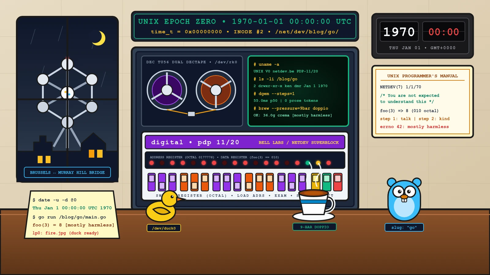
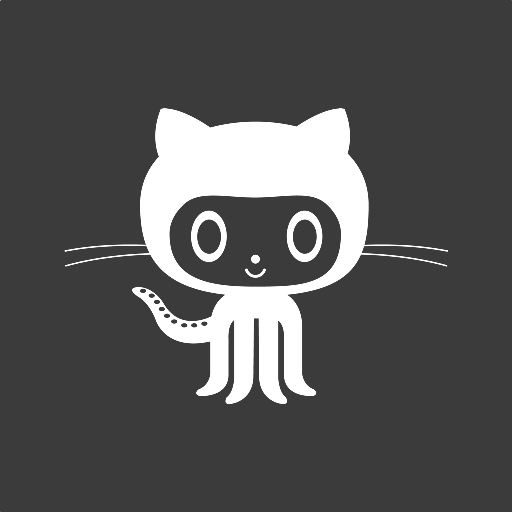

Open carefully. I'm mostly `harmless`.

If you scrolled all the way to the bottom of the [`/net/dev` blog archive](/blog/) and wondered why a mysterious dispatch at **`/blog/go/`** is timestamped **January 1, 1970**, congratulations: you have just stumbled into **Inode `#2`**—the accidental time machine of this website.


*Thursday, January 1, 1970 — 00:00:00 UTC (`time_t t = 0`): Where Bell Labs Room 2C-518 in Murray Hill meets a rainy Brussels atelier over a 9-bar espresso doppio, an ASR-33 Teletype, a yellow debugging duck, and a time-traveling Go gopher.*

---

## 1. Easter Egg `#0` · The `new Date(0)` Wormhole (Why This Page Lives in 1970)

Every good system has a ghost in the machine. Ours came from four lines of TypeScript in [`src/pages/blog/index.astro`](/blog/).

When this primordial test file (`2017-06-20-first-post.md`) was migrated with a custom frontmatter override—`slug: "go"`—and **no explicit `date:` field**, Astro replaced `post.id` (`"2017-06-20-first-post"`) with `"go"`. When the blog index sorted the archive, it ran this fallback cascade:

```typescript
// src/pages/blog/index.astro — The Accidental Bell Labs Time Machine
function getPostDate(post: CollectionEntry<'blog'>): Date {
  if (post.data.pubDate) return new Date(post.data.pubDate);
  if (post.data.date)    return new Date(post.data.date);

  // When slug === "go", post.id is "go" — regex match returns null!
  const match = post.id.match(/(?:^|\/)(\d{4}-\d{2}-\d{2})/);
  if (match) return new Date(match[1]);

  // Welcome to Thursday, 01 Jan 1970 00:00:00 GMT (UNIX Epoch t = 0)
  return new Date(0);
}
```

Instead of crashing, JavaScript calmly returned **`new Date(0)`** (`0x00000000` seconds since the UNIX Epoch). Rather than "fixing" the bug, we promoted it to a **permanent architectural invariant**: every filesystem needs a root superblock anchored at `t = 0`.

<div class="box-note">
<strong>Historical Synchrony (1970 ↔ 2009 ↔ 2026):</strong><br>
Naming this timeless root slug <code>/blog/go/</code> turned out to be unintentionally prophetic. In <strong>1970</strong>, <strong>Ken Thompson</strong> and <strong>Dennis Ritchie</strong> were bringing up UNIX on a DEC PDP-7 and PDP-11/20 at Bell Labs, distilling BCPL into <strong>B</strong> and <strong>C</strong>. Exactly thirty-nine years later, Ken Thompson teamed up with <strong>Rob Pike</strong> and <strong>Robert Griesemer</strong> at Google to design <strong>Go (<code>golang</code>)</strong>—the very language powering our <a href="/blog/2026-09-22-open-knowledge-format-okf-brain-visualizer-wikiskill-ai-cafe/">OKF Spanner Graph Vault</a> and cloud-native microservices today.
</div>

---

## 2. Interactive PDP-11 / UNIX V0 Teletype (`tty0 @ /net/dev`)

Don't just read about 1970—toggle the front-panel switches yourself. Below is a live, browser-native **DEC PDP-11/20 UNIX V0 console** connected to the `/net/dev` superblock. Click any preset command chip or type `help`, `ls`, `man netdev`, `cat /etc/motd`, `brew doppio`, `foo 3`, `dgem`, `date`, or `fortune`:

<div class="pdp11-console" id="pdp11-console">
  <div class="pdp11-topbar">
    <div class="pdp11-leds">
      <span class="pdp11-led led-red" title="RUN"></span>
      <span class="pdp11-led led-amber" title="BUS"></span>
      <span class="pdp11-led led-green" title="USER"></span>
      <span class="pdp11-title">DEC PDP-11/20 • /dev/tty0 (ASR-33 110 BAUD)</span>
    </div>
    <div class="pdp11-clock" id="pdp11-epoch-clock">time_t = 0</div>
  </div>
  <div class="pdp11-chips" role="toolbar" aria-label="PDP-11 quick commands">
    <button type="button" class="pdp11-chip" data-cmd="help">help</button>
    <button type="button" class="pdp11-chip" data-cmd="ls -li /net/dev">ls -li /net/dev</button>
    <button type="button" class="pdp11-chip" data-cmd="cat /etc/motd">cat /etc/motd</button>
    <button type="button" class="pdp11-chip" data-cmd="man 7 netdev">man 7 netdev</button>
    <button type="button" class="pdp11-chip" data-cmd="brew doppio">brew doppio</button>
    <button type="button" class="pdp11-chip" data-cmd="brew flat_white">brew flat_white</button>
    <button type="button" class="pdp11-chip" data-cmd="foo 3">foo(3)</button>
    <button type="button" class="pdp11-chip" data-cmd="dgem --steps=1">dgem --steps=1</button>
    <button type="button" class="pdp11-chip" data-cmd="fortune">fortune</button>
    <button type="button" class="pdp11-chip" data-cmd="clear">clear</button>
  </div>
  <div class="pdp11-screen" id="pdp11-screen" aria-live="polite"></div>
  <form class="pdp11-input-row" id="pdp11-form" autocomplete="off">
    <label for="pdp11-input" class="pdp11-prompt">#</label>
    <input type="text" id="pdp11-input" class="pdp11-input" placeholder="Type a 1970 UNIX command (try: help, man 7 netdev, brew doppio, uname -a)..." />
  </form>
</div>

<style>
  .pdp11-console {
    background: #070d09;
    border: 2px solid #1f3d2b;
    border-radius: 12px;
    box-shadow: 0 14px 34px rgba(0, 0, 0, 0.35), inset 0 0 24px rgba(16, 185, 129, 0.08);
    font-family: "Fira Code", "JetBrains Mono", Consolas, monospace;
    margin: 1.75rem 0;
    overflow: hidden;
    color: #34d399;
  }
  .pdp11-topbar {
    background: #0f1c14;
    border-bottom: 1px solid #1f3d2b;
    padding: 0.6rem 1rem;
    display: flex;
    flex-wrap: wrap;
    justify-content: space-between;
    align-items: center;
    gap: 0.5rem;
    font-size: 0.78rem;
  }
  .pdp11-leds {
    display: flex;
    align-items: center;
    gap: 0.45rem;
  }
  .pdp11-led {
    width: 10px;
    height: 10px;
    border-radius: 50%;
    display: inline-block;
  }
  .led-red { background: #ef4444; box-shadow: 0 0 8px #ef4444; }
  .led-amber { background: #f59e0b; box-shadow: 0 0 8px #f59e0b; }
  .led-green { background: #10b981; box-shadow: 0 0 8px #10b981; }
  .pdp11-title {
    color: #a7f3d0;
    font-weight: 700;
    letter-spacing: 0.04em;
    margin-left: 0.35rem;
  }
  .pdp11-clock {
    color: #fbbf24;
    font-weight: 600;
    font-size: 0.76rem;
    background: rgba(245, 158, 11, 0.12);
    border: 1px solid rgba(245, 158, 11, 0.35);
    padding: 0.15rem 0.55rem;
    border-radius: 6px;
  }
  .pdp11-chips {
    display: flex;
    flex-wrap: wrap;
    gap: 0.4rem;
    padding: 0.6rem 1rem;
    background: #0b150f;
    border-bottom: 1px solid #162c1f;
  }
  .pdp11-chip {
    background: rgba(16, 185, 129, 0.1);
    border: 1px solid rgba(52, 211, 153, 0.35);
    color: #6ee7b7;
    font-family: inherit;
    font-size: 0.74rem;
    padding: 0.22rem 0.6rem;
    border-radius: 6px;
    cursor: pointer;
    transition: all 0.15s ease;
  }
  .pdp11-chip:hover,
  .pdp11-chip:focus-visible {
    background: #10b981;
    color: #05100a;
    border-color: #34d399;
    transform: translateY(-1px);
  }
  .pdp11-screen {
    padding: 1rem;
    min-height: 230px;
    max-height: 360px;
    overflow-y: auto;
    font-size: 0.83rem;
    line-height: 1.5;
    white-space: pre-wrap;
    color: #6ee7b7;
  }
  .pdp11-line-cmd {
    color: #fbbf24;
    font-weight: 700;
    margin-top: 0.45rem;
  }
  .pdp11-line-out {
    color: #6ee7b7;
    margin-bottom: 0.35rem;
  }
  .pdp11-input-row {
    display: flex;
    align-items: center;
    background: #0b150f;
    border-top: 1px solid #1f3d2b;
    padding: 0.55rem 1rem;
    gap: 0.6rem;
  }
  .pdp11-prompt {
    color: #fbbf24;
    font-weight: 700;
    font-size: 0.9rem;
    margin: 0;
  }
  .pdp11-input {
    flex: 1;
    background: transparent;
    border: none;
    color: #ecfdf5;
    font-family: inherit;
    font-size: 0.85rem;
    outline: none;
  }
  .pdp11-input::placeholder {
    color: rgba(110, 231, 183, 0.45);
  }
</style>

<script is:inline>
  (function () {
    var screen = document.getElementById('pdp11-screen');
    var form = document.getElementById('pdp11-form');
    var input = document.getElementById('pdp11-input');
    var clockEl = document.getElementById('pdp11-epoch-clock');
    var chips = document.querySelectorAll('.pdp11-chip');
    if (!screen || !form || !input) return;

    var fortunes = [
      '/* You are not expected to understand this. */ — John Lions, UNIX V6 slp.c:2238 (1976)',
      'lp0 on fire (and Yellow Duck spotted on /dev/tty0) — Bell Labs & /net/dev diagnostics',
      'System Invariant: 9-bar espresso doppio + Franco-Belgian Ligne Claire = 10x cloud architecture.',
      'Why ask an autoregressive LLM to emit 60 JSON tokens when dgem answers 10 booleans in 61.8ms?',
      'ClickOps dies at month six. Protect, Control, Comply/Audit with Cloud Foundation Fabric (FAST).',
      'Keep looking up ¯\\_(ツ)_/¯ — /net/dev superblock motto since time_t = 0.'
    ];
    var fortuneIdx = 0;

    function updateEpochClock() {
      if (!clockEl) return;
      var nowSec = Math.floor(Date.now() / 1000);
      var octSec = '0' + nowSec.toString(8);
      clockEl.textContent = 'time_t = ' + nowSec + 's (octal ' + octSec + ')';
    }
    updateEpochClock();
    setInterval(updateEpochClock, 1000);

    function appendBlock(cmdText, outText) {
      if (cmdText) {
        var cmdDiv = document.createElement('div');
        cmdDiv.className = 'pdp11-line-cmd';
        cmdDiv.textContent = '# ' + cmdText;
        screen.appendChild(cmdDiv);
      }
      var outDiv = document.createElement('div');
      outDiv.className = 'pdp11-line-out';
      outDiv.textContent = outText;
      screen.appendChild(outDiv);
      screen.scrollTop = screen.scrollHeight;
    }

    function runCommand(raw) {
      var cmd = raw.trim();
      if (!cmd) return;
      var lower = cmd.toLowerCase();

      if (lower === 'clear') {
        screen.replaceChildren();
        return;
      }
      if (lower === 'help') {
        appendBlock(cmd, [
          'UNIX V0 / PDP-11 MONITOR — AVAILABLE COMMANDS:',
          '  ls -li /net/dev   List primordial inodes mounted at time_t = 0',
          '  cat /etc/motd     Read Ken & Dennis message of the day (Room 2C-518)',
          '  man 7 netdev      Display NETDEV(7) UNIX Programmer\'s Manual page',
          '  brew doppio       Pull a 9-bar espresso doppio via /dev/doppio',
          '  brew flat_white   Attempt an unauthorized milky beverage',
          '  foo 3             Execute the primordial 2017 closure foo(3)',
          '  dgem --steps=1    Fire 1-step bidirectional diffusion switchboard',
          '  uname -a          Print PDP-11 kernel & Brussels bridge telemetry',
          '  date              Compare Epoch Zero (t=0) with live wall-clock time_t',
          '  whoami            Print active operator UID/GID',
          '  fortune           Print a Bell Labs / Brussels engineering aphorism',
          '  clear             Clear ASR-33 paper scroll'
        ].join('\n'));
        return;
      }
      if (lower.indexOf('ls') === 0) {
        appendBlock(cmd, [
          'total 42 (superblock: /net/dev, mounted RW at t = 0)',
          '   2 drwxr-xr-x  2 ken   dmr       512 Jan  1  1970 /blog/go/',
          '   8 crw-rw-rw-  1 jpaq  barista  9, 0 Jan  1  1970 /dev/doppio',
          '  14 brw-r--r--  1 jpaq  vinyl   16, 7 Sep 14  2026 /dev/barogroove',
          '  26 crw-xr-xr-  1 jpaq  gemma   55, 1 Oct 31  2026 /proc/sys/net/dgem',
          '  31 -r--r--r--  1 jpaq  secops  22908 Sep 12  2026 /etc/fast/org.hcl',
          '  42 crw-------  1 jpaq  rubber   1, 1 Jan  1  1970 /dev/duck0'
        ].join('\n'));
        return;
      }
      if (lower === 'cat /etc/motd' || lower === 'motd') {
        appendBlock(cmd, [
          '***********************************************************************',
          '* BELL TELEPHONE LABORATORIES — MURRAY HILL, NJ (ROOM 2C-518)         *',
          '* THU JAN 1 00:00:00 GMT 1970 (UNIX EPOCH ZERO)                       *',
          '***********************************************************************',
          'Notice to night-shift operators:',
          '1. Someone left a 9-bar Belgian espresso doppio, a yellow rubber duck,',
          '   and a blue stuffed rodent labeled "go" on top of the PDP-11 cabinet.',
          '2. Do NOT remove inode #2 (/blog/go/). It anchors the 2026 Astro build.',
          '3. Remember: step 1 = talk. step 2 = be kind. last advice = mostly harmless.'
        ].join('\n'));
        return;
      }
      if (lower.indexOf('man') === 0) {
        appendBlock(cmd, [
          'NETDEV(7)              UNIX Programmer\'s Manual              NETDEV(7)',
          '',
          'NAME',
          '     netdev -- Brussels Ligne Claire & Cloud Architecture superblock',
          '',
          'SYNOPSIS',
          '     #include <sys/types.h>',
          '     #include <netdev/doppio.h>',
          '     int brew(int bar_pressure, const char *roast); /* bar_pressure == 9 */',
          '',
          'DESCRIPTION',
          '     /net/dev bridges 1970 Bell Labs simplicity ("do one thing well")',
          '     with 2026 Google Cloud architecture, Agentic SRE, and Belgian',
          '     strip-album storytelling.',
          '',
          'DIAGNOSTICS',
          '     EFLATWHITE (errno 418)  Operator requested steamed milk; rejected.',
          '     ECLICKOPS  (errno 403)  Unversioned console mutation; use FAST IaC.',
          '     EHARMLESS  (errno 42)   Open carefully. Mostly harmless.'
        ].join('\n'));
        return;
      }
      if (lower === 'brew doppio') {
        appendBlock(cmd, [
          '[ioctl /dev/doppio] Heating brass grouphead to 93.0 C...',
          '[ioctl /dev/doppio] Engaging 9.0 bar rotary pump (18.0g in -> 36.0g out in 26s)...',
          '☕ Espresso Doppio ready. Crema hazelnut-tiger-striped. Zero milk added.'
        ].join('\n'));
        return;
      }
      if (lower.indexOf('flat_white') !== -1 || lower.indexOf('latte') !== -1) {
        appendBlock(cmd, [
          'brew: /dev/doppio: EFLATWHITE (errno 418 I\'m a Moka Pot)',
          'KERNEL PANIC prevented: This Brussels atelier runs strictly on Espresso Doppio.'
        ].join('\n'));
        return;
      }
      if (lower.indexOf('foo') === 0) {
        appendBlock(cmd, [
          '> var foo = function(x) { return (x + 5); };',
          '> foo(3)',
          '8 (decimal) == 010 (PDP-11 octal) == 0x08 (ASCII Backspace) — Invariant verified!'
        ].join('\n'));
        return;
      }
      if (lower.indexOf('dgem') === 0) {
        appendBlock(cmd, [
          '[dgem /proc/sys/net/dgem] google/diffusiongemma-26B-A4B-it (steps=1)',
          '  Q1 [urgent?]       -> yes (p=0.994, H=2.1%)',
          '  Q2 [auto_refund?]  -> yes (p=0.988, H=3.4%)',
          '  Q3 [harmless?]     -> mostly (p=0.999, H=0.4%)',
          '✔ 10 policy slots resolved in 55.0 ms server p50 (0 prose tokens emitted).'
        ].join('\n'));
        return;
      }
      if (lower.indexOf('uname') === 0) {
        appendBlock(cmd, 'UNIX V0 netdev.be 0.1970.01.01 #1 THU JAN 1 00:00:00 GMT 1970 PDP-11/20 (MurrayHill-Brussels-LigneClaire)');
        return;
      }
      if (lower === 'date') {
        var now = Math.floor(Date.now() / 1000);
        appendBlock(cmd, [
          'Inode Anchor : Thu Jan  1 00:00:00 UTC 1970 (time_t = 0, octal 00)',
          'Wall Clock   : ' + new Date().toUTCString() + ' (time_t = ' + now + ')',
          '32-bit Y2K38 : ' + (2147483647 - now) + ' seconds remaining until 0x7FFFFFFF rollover'
        ].join('\n'));
        return;
      }
      if (lower === 'whoami' || lower === 'id') {
        appendBlock(cmd, 'uid=0(jpaquay) gid=0(architect) groups=0(root),9(doppio),42(mostly-harmless),1970(bell-labs)');
        return;
      }
      if (lower === 'fortune') {
        var f = fortunes[fortuneIdx % fortunes.length];
        fortuneIdx++;
        appendBlock(cmd, f);
        return;
      }
      appendBlock(cmd, cmd.split(' ')[0] + ': not found in /bin or /usr/bin (1970 tape). Type "help" for available commands.');
    }

    appendBlock('', [
      'UNIX V0 (DEC PDP-11/20) — /net/dev Temporal Superblock [Thu Jan 1 00:00:00 UTC 1970]',
      'Login: jpaquay on /dev/tty0 (110 baud ASR-33 Teletype)',
      'Type "help" or click any command chip above to inspect inode #2.'
    ].join('\n'));

    form.addEventListener('submit', function (e) {
      e.preventDefault();
      var val = input.value;
      input.value = '';
      runCommand(val);
    });

    chips.forEach(function (chip) {
      chip.addEventListener('click', function () {
        var c = chip.getAttribute('data-cmd') || '';
        runCommand(c);
      });
    });
  })();
</script>

---

## 3. Easter Egg `#1` · `/* You are not expected to understand this */` (`swtch()`, 1970 ↔ 2026)

Every systems engineer carries a soft spot for line `2238` of `slp.c` in **John Lions' *Commentary on UNIX 6th Edition* (1976)**—where Ken Thompson saved the stack pointer inside `swtch()` and left the most famous six-word comment in computing history.

If you dump the core memory (`core.0`) of `/blog/go/` with `od -c`, you'll find the exact context switch that bridges our 1970 PDP-11 superblock with our 2026 Brussels cloud architecture:

```c
/*
 * usr/sys/ken/netdev_swtch.c — 1st Edition UNIX (1970) / Brussels Aether Patch
 *
 * Switch the CPU from PID 0 (1970 Murray Hill Swapper) to PID 42 (2026 /net/dev)
 */
#include "../param.h"
#include "../user.h"
#include "../proc.h"

#define ESPRESSO_BARS   9       /* Strict 9-bar hydrostatic invariant       */
#define BRUSSELS_HPA    1013    /* Barogroove reference barometric pressure */
#define DGEM_STEPS      1       /* 1-step bidirectional diffusion canvas    */
#define ENOFLATWHITE    418     /* Reject steamed milk on /dev/doppio       */

int
swtch_to_netdev(struct proc *p)
{
    register int r5; /* PDP-11 frame pointer */

    if (u.u_coffee != ESPRESSO_BARS) {
        u.u_error = ENOFLATWHITE;
        panic("flat white detected in Brussels atelier");
    }

    /*
     * If barometric pressure drops over Schaerbeek, pipe 160,717 Last.fm
     * scrobbles directly into /dev/barogroove before waking the GPU.
     */
    if (barometer_hpa() < BRUSSELS_HPA) {
        barogroove_forge(u.u_scrobbles, 160717L);
    }

    /*
     * You are not expected to understand this.
     *
     * Instead of spinning 60 autoregressive tokens for a boolean, we jump
     * across 56 years of silicon in a single dgem forward pass (steps=1).
     */
    savu(u.u_rsav);
    retu(p->p_addr);
    return (foo(3)); /* returns 010 octal == 8 decimal */
}
```

---

## 4. Easter Egg `#2` · From `1970` UNIX Pipes (`|`) to `2026` Agentic Pipelines

In **1973**, **Douglas McIlroy** finally convinced Ken Thompson to add the **pipe operator (`|`)** to UNIX overnight, crystallizing the timeless **UNIX Philosophy**:

1. *Write programs that do one thing and do it well.*
2. *Write programs to work together.*
3. *Write programs to handle text streams, because that is a universal interface.*

Fifty-six years later, when we wire [**`dgem` (Decision Diffusion Gemma)**](/blog/2026-10-31-dgem-diffusion-gemma-system-one-routing-brussels/), [**Barogroove**](/blog/2026-09-14-barogroove-barometer-daylist-ai-lastfm/), [**Cloud Foundation Fabric (FAST)**](/blog/2026-09-12-gcp-organization-security-finops-fast-fabric/), and [**GKE Scale-to-Zero**](/blog/2026-09-28-scale-to-zero-gke-netdev-edge-agentic-mission-control/) together in `europe-west1`, we are still writing UNIX pipes—only the file descriptors now carry typed logits, OpenTelemetry traces, and barometric telemetry:

```mermaid
flowchart LR
    subgraph UNIX1970["1970 • Bell Labs PDP-11 Pipe (McIlroy, Thompson, Ritchie)"]
        direction LR
        T1["cat /dev/tty0"] -->|fd 0/1| T2["grep 'urgent'"]
        T2 -->|pipe '|'| T3["sort -u"]
        T3 -->|fd 1| T4["lp0 (ASR-33)"]
    end

    subgraph NETDEV2026["2026 • /net/dev Brussels Cloud-Native & Agentic Pipe"]
        direction LR
        A1["stdin: Event / Barometer / Ticket"] -->|61.8 ms, steps=1| A2["dgem Switchboard (10 Typed Booleans)"]
        A2 -->|"Hesitation < 16% (66%)"| A3["Deterministic Fast-Path / Barogroove"]
        A2 -->|"Hesitation >= 16% (34%)"| A4["Stage 2 Gemini 3.8 Flash"]
        A3 --> A5["stdout: FAST Landing Zone (europe-west1)"]
        A4 --> A5
    end

    UNIX1970 ===>|"time_t = 0 -> 1,793,700,000+"| NETDEV2026
```

### The `slug: "go"` Time-Capsule Program

Why is this URL `/blog/go/`? Because **Ken Thompson** co-invented **UNIX** in **1970** and co-invented **Go** in **2009**. Here is the official `/blog/go/` polyglot sanity check—preserving the original `foo(3)` closure from the 2017 markdown template inside idiomatic Go:

```go
// $ go run netdev_epoch.go
package main

import (
	"fmt"
	"time"
)

// The primordial 2017 /blog/go/ closure:
// var foo = function(x) { return(x + 5); }; foo(3)
func foo(x int) int {
	return x + 5
}

func main() {
	epoch := time.Unix(0, 0).UTC()
	fmt.Printf("Inode #2 Booted : %s (unix=%d)\n", epoch.Format(time.RFC3339), epoch.Unix())
	fmt.Printf("foo(3)          : %d (decimal) == 0%o (PDP-11 octal)\n", foo(3), foo(3))
	fmt.Printf("Atelier Advice  : step 1 = talk | step 2 = be kind | status = mostly harmless\n")
}
```

---

## 5. Easter Egg `#3` · The Original `/blog/go/` Relics (Decoded in PDP-11 Octal)

For longtime visitors who remember the original starter template that lived at `/blog/go/` (*"All the front matter variables available in Congo"*), every single artifact is still right here—now annotated with the Bell Labs diagnostics it was hiding all along:

> Both menus are completely optional and can be commented out if not required. Use the template provided in the [file](/aboutme) as a guide.

```javascript
// The original 2017 snippet that survived the time warp to 1970:
var foo = function(x) {
  return(x + 5);
}
foo(3) // => 8 (010 in PDP-11 octal: the exact byte offset of the UNIX V1 superblock!)
```

<div class="box-note">
If you now run <code>hugo server</code> (or mount <code>/dev/rk0</code> on a DEC RK05 disk pack) you will be presented with the Three Laws of the <code>/net/dev</code> Atelier:

#### step 1
## talk
#### step 2
## be kind
#### Last advice
## keep looking up `¯\_(ツ)_/¯`
</div>

<div class="box-error">
<strong>KERNEL DIAGNOSTIC (<code>lp0 on fire</code> — 1970 / 2023 Rant Edition):</strong><br>
When a line printer catches fire at Bell Labs or an autoregressive JSON parser stalls in production, consult the Yellow Rubber Duck on <code>/dev/duck0</code> before paging on-call:


</div>

### The "Useless Table" — Now Decoded as the PDP-11 Interrupt & Inode Map

In the original post, this table looked like a random list of numbers. Look closer at the arithmetic (`Number`, `Next = n + 1`, `Previous = n - 1`) and their **PDP-11 Octal / UNIX File Descriptor** assignments:

| Number (`n`) | Next (`++n`) | Previous (`--n`) | Octal (`0n`) | 1970 UNIX & `/net/dev` Kernel Meaning |
| :--- | :--- | :--- | :--- | :--- |
| **Five** | Six | Four | `005` | **`SIGTRAP` (`5`)** — PDP-11 trace trap used by `db` / `adb` and our SRE OpenTelemetry spans. |
| **Ten** | Eleven | Nine | `012` | **`012` Octal = `\n` (ASCII Line Feed `10`)** — The single-byte UNIX newline that ended CRLF tyranny forever. |
| **Seven** | Eight | Six | `007` | **`007` Octal = `BEL` (`^G`)** — Rings the physical mechanical bell on an ASR-33 Teletype when the espresso doppio finishes extracting. |
| **Two** | Three | One | `002` | **`fd = 2` (`stderr`) & `Inode #2` (`/`)** — The root directory inode of a UNIX filesystem (and `/blog/go/`!). |

It can also be a centered logo!



# mostly `harmless` (`errno = 42`)
