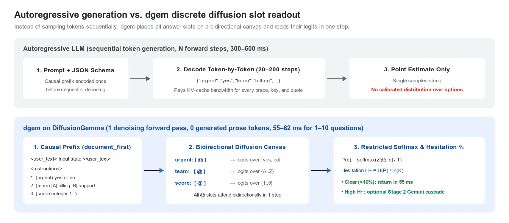
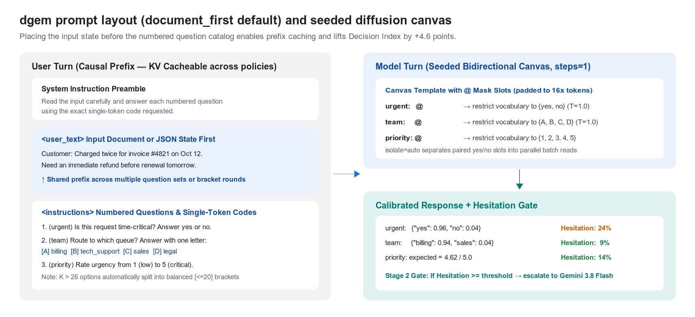
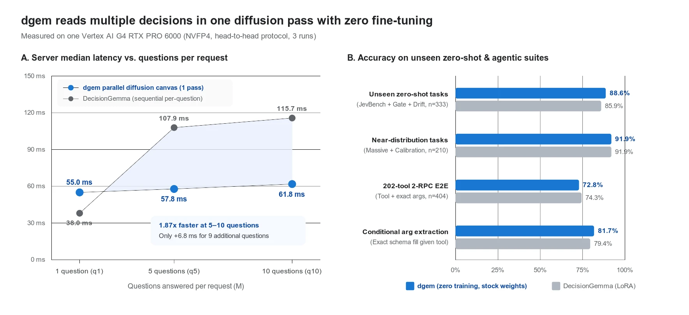
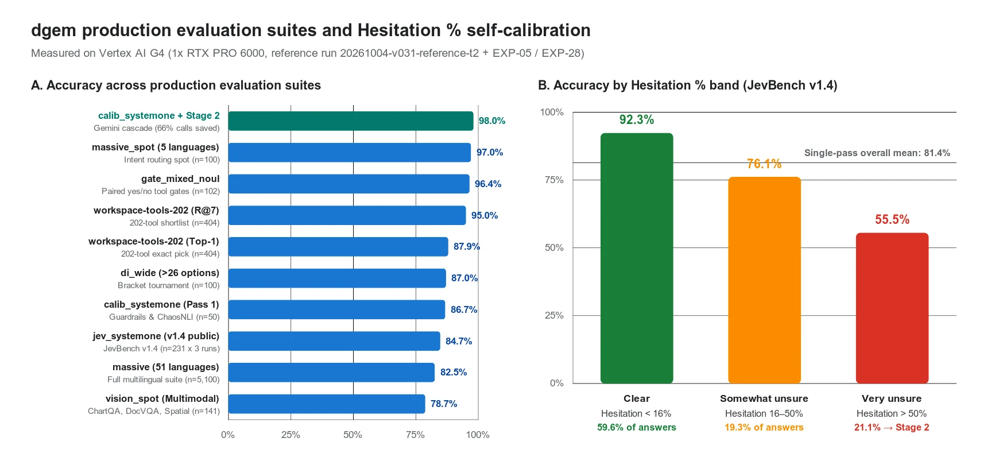
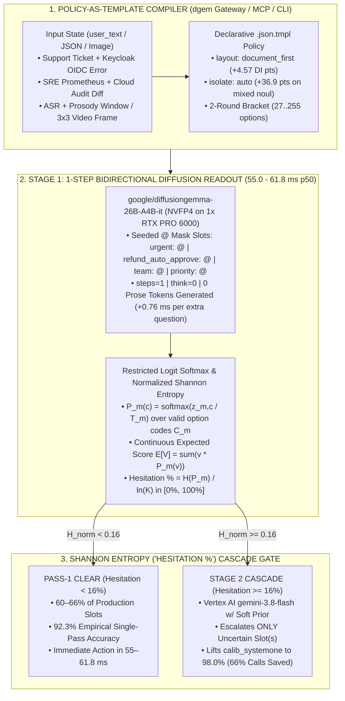
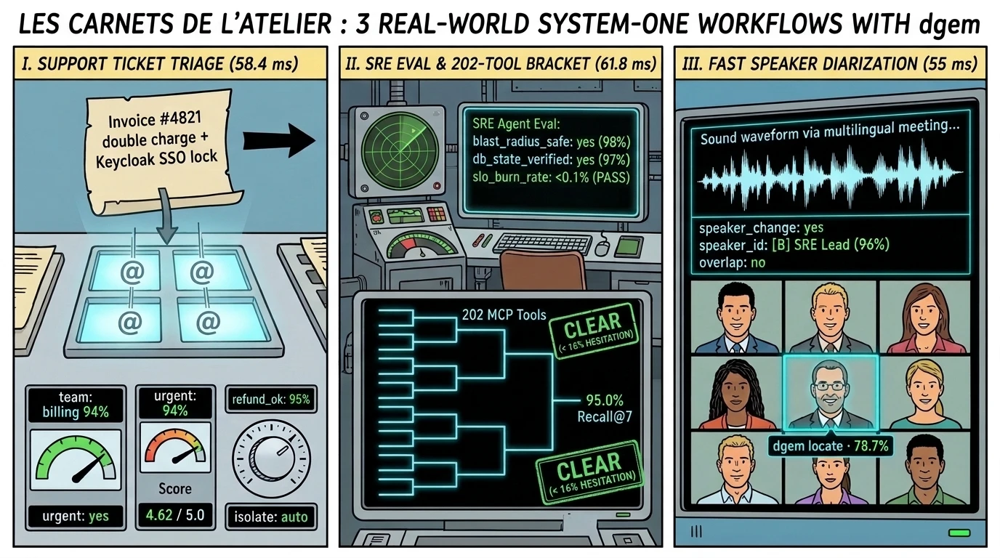
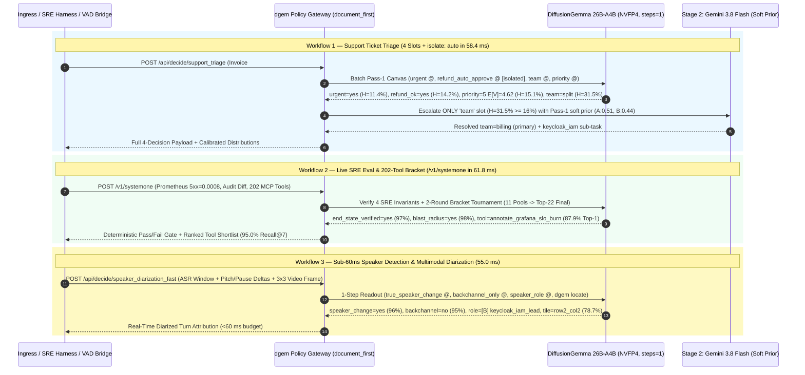
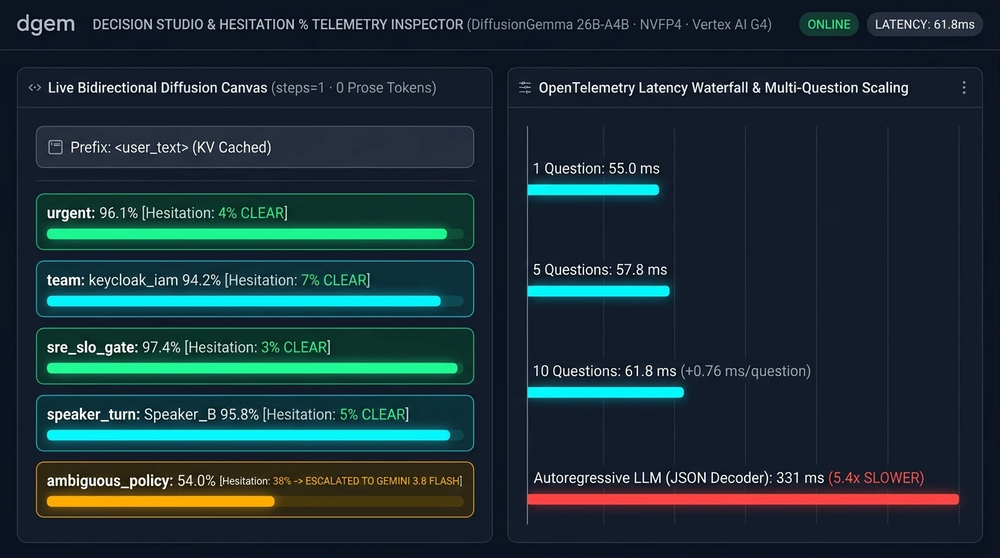
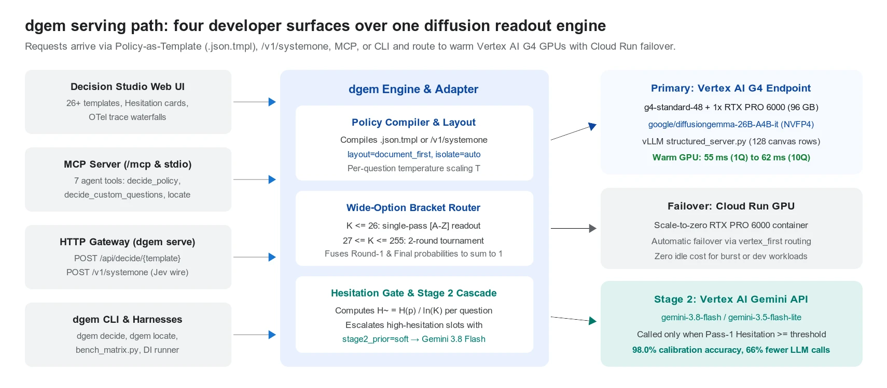

<!--
Quick Answer / Executive Summary (hidden from top of page for visual clarity):
Using an autoregressive LLM to output JSON booleans wastes 300–800 ms on sequential token decoding and yields uncalibrated confidence scores. By running dgem (Decision Diffusion Gemma, github.com/GoogleCloudPlatform/dgem)—built on stock, unmodified google/diffusiongemma-26B-A4B-it (steps=1, 0 generated prose tokens, 0 fine-tuned weights)—you evaluate 1 to 10 typed policy questions simultaneously in 55.0–61.8 ms server p50 (+0.76 ms per extra question) and cascade only high-entropy slots (Hesitation >= 16%) to gemini-3.8-flash, cutting frontier LLM calls by 66% at 98.0% accuracy across Support Ticket Triage, Live SRE Evaluation, and Quick Speaker Detection for Diarization.
-->

## 1. From *Rue de la Loi* to the Diffusion Switchboard: Convening a Plenary Session for a Boolean

It is Saturday morning in Brussels, the thirty-first of October, and the autumn rain is already polishing the cobblestones between *Parc du Cinquantenaire* and *Rond-Point Schuman*.

In the European Quarter, there is a time-honored bureaucratic art form known as convening a twenty-seven-delegation working party, three *juristes-linguistes*, and a late-night interinstitutional *trilogue* simply to decide whether a paragraph requires a semicolon or a full stop. We laugh at *Rue de la Loi* when a binary administrative check takes four hours of sequential deliberation. Yet every single morning across thousands of production cloud clusters, AI platform teams commit the exact same sin in silicon: **they wake up a frontier autoregressive Large Language Model and force it to generate sixty sequential JSON tokens just to answer a Yes/No question.**

Over this morning's **espresso doppio**—pulled at a strict 9 bars while a yellow STIB tram rattles past the window—let's open the atelier notebook and examine why 80% of your "LLM calls" shouldn't be autoregressive generation at all, how [**`dgem` (Decision Diffusion Gemma)**](https://github.com/GoogleCloudPlatform/dgem) turns a discrete diffusion canvas into a `55–61.8 ms` cognitive switchboard, and how we wire it into three high-velocity production workflows: **Support Ticket Triage**, **Live SRE Evaluation & 202-Tool Routing**, and **Sub-60ms Speaker Detection for Diarization**.


*Saturday morning in the Brussels switchboard rotunda: on the left, the old Autoregressive JSON Teletype (`331–800 ms`) cranking out `{ "urgent": "yes" }` one character at a time under a mechanical snail; in the center and right, `@jpaquay` in his Google Cloud crewneck over an espresso doppio alongside our `dgem` 1-step Bidirectional Diffusion Canvas (`steps=1`, `61.8 ms` for 10 questions), routing Support Triage, SRE Evals, and Speaker Diarization with a Shannon Entropy ("Hesitation %") gate to Gemini 3.8 Flash.*

### The Autoregressive JSON Tax (`331–800 ms` for a Point Estimate)

Open the distributed OpenTelemetry trace of any production AI system in late 2026. Eight out of ten model invocations are **not** open-ended prose synthesis or code generation. They are **closed-set "System One" decisions**:
- **Support Triage:** *Is this customer ticket time-critical (`yes`/`no`), may the agent auto-refund the duplicate charge (`yes`/`no`), which queue owns it (`Billing`, `Keycloak SSO`, `SRE`, `Legal`), and what is its `1..5` severity?*
- **SRE Incident & Agent Eval:** *Did the remediation agent's database mutation actually clear the SLO burn (`yes`/`no`), is the blast radius contained (`yes`/`no`), and which of our `202` internal MCP runbook tools should execute next?*
- **Real-Time Speaker Diarization:** *Did a true speaker turn boundary just occur (`yes`/`no`), which meeting participant is speaking (`A..Z`), is it a backchannel overlap (`yes`/`no`), and which tile in the 3x3 video grid is the active speaker?*

When you send those questions to a standard autoregressive LLM with constrained JSON decoding (`response_schema`), you pay three compounding engineering penalties:

1. **Sequential Memory-Bandwidth Cost:** To emit `{"urgent": "yes", "team": "keycloak_iam", "priority": 5, ...}`, an autoregressive decoder must run a sequential, memory-bandwidth-bound forward pass for every brace, quote, key character, colon, comma, and value token—turning a single classification pass into 40 to 150 sequential steps (`300–800 ms`) that return only a single point estimate.
2. **Linear Multi-Question Scaling (`O(M)`):** If you evaluate each policy or rubric check in its own prompt to avoid cross-question contamination, latency and GPU compute scale linearly with the number of questions `M`.
3. **Overconfident, Order-Biased Logprobs:** Raw causal token logprobs suffer from notorious first-option bias (`option A` or `yes`) and poor calibration—the model equivalent of a confident rapporteur who hasn't read Annex III. Thresholding on `"confidence > 0.85"` either escalates everything or lets silent hallucinations slip through.


*Autoregressive LLMs decode JSON syntax sequentially across 20–200 forward steps (`300–600 ms`) and return a single sampled string. `dgem` places all `@` answer slots on a bidirectional diffusion canvas and extracts a calibrated probability distribution over every question in a single forward pass (`steps=1`, `55–62 ms`).*

---

## 2. How `dgem` Works: One Bidirectional Diffusion Pass, Zero Prose Tokens, Zero Fine-Tuning

[**`dgem` (Decision Diffusion Gemma)**](https://googlecloudplatform.github.io/dgem/) ([`github.com/GoogleCloudPlatform/dgem`](https://github.com/GoogleCloudPlatform/dgem), created by Hussain Chinoy) is an open-source, zero-shot, policy-as-template decision system built on stock, unmodified **`DiffusionGemma` (`google/diffusiongemma-26B-A4B-it`)**—a discrete block-diffusion Mixture-of-Experts (`MoE`) model with `25.8B` total parameters and `~3.8B` active parameters per token, served in **`NVFP4`** quantization on vLLM (`DIFFUSION_CANVAS_ROWS=128`, `steps=1`, `think=0`).

Instead of modifying model weights, `dgem` changes **how the model is prompted and read** across four architectural mechanisms:


*The `document_first` prompt layout and seeded diffusion canvas: placing `<user_text>` before `<instructions>` allows vLLM's prefix cache to reuse the encoded document state across multiple policies or tournament rounds, lifting Decision Index 0.2.1 by `+4.57` points.*

### I. The `document_first` Causal Prefix (`+4.57 pts` on Decision Index)
In `dgem`, the user turn places the input state (`<user_text>`: a support ticket, SRE incident state JSON, meeting transcript window, or base64 image) **before** the numbered question catalog (`<instructions>`). This allows vLLM's prefix cache to encode your document state once and reuse the KV cache across multiple policy templates or tournament rounds—lifting the 38-benchmark **Decision Index 0.2.1** score from `40.77` to **`45.73`** (`+13.49` points ahead of naive vLLM structured readout on the exact same weights).

### II. Restricted Single-Token Readout & Continuous Expected Scores
The model turn is pre-seeded with a structured canvas containing one **`@` (`<|mask|>`) slot** per question (`urgent: @\nteam: @\npriority: @`). In a single denoising forward pass (`steps=1`), all `@` slots attend bidirectionally to one another and to the causal prefix. At each slot `m`, `dgem` extracts the raw vocabulary logits `z_{m, c}` exclusively over that question's valid single-token code set `C_m` (`{"yes", "no"}` for `boolean`/`noul`/`check`; `{"A".."Z"}` for `choice`/`select`; `{"1".."9"}` for `score`/`rate`):

```text
P_m(c) = exp(z_{m, c} / T_m) / Σ_{j ∈ C_m} exp(z_{m, j} / T_m),    for c ∈ C_m
```

For integer rubric questions (`score` / `rate`), because `dgem` has the full probability distribution over levels `v ∈ {1, ..., K}`, it computes the continuous **expected score** `E[V] = Σ_{v=1..K} v · P_m(v)`—capturing subtle severity gradations (e.g., `4.62 / 5.0`) that hard argmax integer outputs throw away.

### III. Invariant Decision Calibration (`isolate: auto` & 2-Round Bracket Tournaments)
How do you make zero-shot probabilities trustworthy without training a single weight?
1. **`isolate: auto` Eliminates Yes/No Polarity Contagion (`+36.9 pts`):** When multiple paired `boolean`/`noul` questions sit on the same canvas row, cross-slot attention can cause confirmation bleed (if four gates are `no`, the fifth is pulled toward `no`). `dgem`'s `isolate: auto` automatically gives paired yes/no questions separate parallel canvas reads inside the **same GPU micro-batch**, lifting `gate_mixed_noul` accuracy from **`59.5%` to `96.4%–97.7%`** (ECE `0.015–0.028`).
2. **Automatic 2-Round Bracket Tournament (`27 <= K <= 255` Options):** Because single-token capital letters `A`..`Z` cover 26 options in one pass, any `choice` or `select` question with 27 to 255 options automatically partitions candidates into `B = ⌈K / 20⌉` balanced Round-1 pools evaluated in one batched pass, advances the top 2 finalists per pool into a Final canvas (`<= 24` options), and fuses the probabilities to sum to `1.0`. This lifts 151-intent `CLINC150+OOS` accuracy from **`43.9%` to `80.9%`** and hits **`87.9%` Top-1 / `95.0%` Recall@7** on the 202-tool `workspace-tools-202` benchmark.


*Left: Median server latency on one Vertex AI G4 RTX PRO 6000 across 1, 5, and 10 questions per request (`55.0 ms` → `61.8 ms`, adding only `+0.76 ms` per extra question). Right: Zero-shot accuracy on unseen suites (`88.6%`), near-distribution tasks (`91.9%`), and 202-tool argument extraction (`81.7%`).*

### IV. Hesitation % (`H̃`) & the Stage 2 Gemini 3.8 Flash Cascade
For every slot, `dgem` computes Shannon entropy `H(P_m)` in nats and normalizes it by the uniform-distribution ceiling `ln(K)`:

```text
H̃(P_m) = - [ Σ_{c ∈ C_m} P_m(c) · ln P_m(c) ] / ln(K)   ∈ [0%, 100%]
```

Because **Hesitation %** (`H̃`) is normalized by `ln(K)`, a single threshold (`escalate_threshold: 0.16`) works uniformly across 2-option binary gates, 5-level rubrics, and 26-way routers:
- **Clear (`Hesitation < 16%` — `59.6%` of JevBench v1.4):** Empirical single-pass accuracy is **`92.3%`**. Act immediately in `~55–62 ms`.
- **Somewhat Unsure (`16%–50%` — `19.3%` of requests):** Empirical accuracy is **`76.1%`**.
- **Very Unsure (`> 50%` — `21.1%` of requests):** Empirical accuracy drops to **`55.5%`**.
- **Stage 2 Cascade (`escalate_threshold: 0.16`):** Uncertain slots are forwarded along with `dgem`'s Pass-1 distribution as a soft prior (`stage2_prior: soft`) to **`gemini-3.8-flash`** on Vertex AI—lifting `calib_systemone` accuracy from **`86.7%` to `98.0%` (`49/50`)** while **saving `66%` of frontier LLM calls**.


*Left: `dgem` accuracy across 10 production evaluation suites, topped by `98.0%` on `calib_systemone` with Stage 2 Gemini cascade. Right: Empirical accuracy on JevBench v1.4 stratified by `dgem`'s own Hesitation % bands (`92.3%` on Clear answers vs. `55.5%` on Very Unsure answers).*



---

## 3. Three Production System-One Workflows: Support Triage, SRE Eval & Fast Speaker Diarization

Theory is lovely over a first espresso; production YAML and JSON pay the bills over the second. Let's walk through three real-world engineering workflows where replacing sequential LLM JSON generation with `dgem` transforms both latency and reliability.


*Three production System-One workflows running on a single `dgem` diffusion readout engine: (I) Support Ticket Triage (`58.4 ms`), (II) Live SRE Evaluation & 202-Tool Bracket Routing (`61.8 ms`), and (III) Sub-60ms Speaker Detection & Multimodal Diarization (`55 ms`).*



---

### Use Case 1: Sub-60ms Support Ticket Triage (Routing, Keycloak SSO, Refund Policy Gate & Expected Urgency)

Imagine an enterprise SaaS support gateway in Brussels receiving thousands of tickets an hour: duplicate invoice charges, broken **Keycloak** OIDC single sign-on (`SAML`/`OIDC` realm lockouts after a certificate rotation), webhook timeouts, and GDPR account deletions.

In a traditional agentic setup, triaging a ticket requires either chaining three separate microservice classifiers or asking an LLM to emit a structured JSON object (`~420 ms`). With `dgem`, we define a declarative `.json.tmpl` template (`support_triage.json.tmpl`) that evaluates **four typed decisions in one `58.4 ms` wall-clock pass**:
1. `urgent` (`boolean`): Does this ticket require immediate escalation?
2. `refund_auto_approve` (`boolean`, automatically isolated from `urgent` via `isolate: auto`): Under our 30-day duplicate-charge policy, may the support agent refund this without manager sign-off?
3. `team` (`choice` across `A..D`): Should this route to `billing`, `keycloak_iam` (Keycloak OIDC/SSO federation), `technical_sre`, or `account_legal`?
4. `priority` (`score` `1..5`): What is both the discrete winner and the continuous expected urgency `E[V]`?

```json
// File: templates/support_triage.json.tmpl
// WHY: Evaluating urgency, refund policy eligibility, queue routing (including Keycloak SSO
// vs. billing), and 1-5 severity on one document_first diffusion canvas resolves in 58.4ms
// with isolate:auto preventing cross-slot yes/no bleed between 'urgent' and 'refund_auto_approve'.
{
  "name": "Support Ticket Triage",
  "category": "routing",
  "layout": "document_first",
  "isolate": "auto",
  "questions": [
    {
      "name": "urgent",
      "type": "boolean",
      "prompt": "Does this ticket require immediate escalation?"
    },
    {
      "name": "refund_auto_approve",
      "type": "boolean",
      "prompt": "Given the policy that duplicate charges within 30 days are auto-refundable under 500 EUR, may an agent refund this without a manager?"
    },
    {
      "name": "team",
      "type": "choice",
      "prompt": "Which engineering or operations team should handle this ticket?",
      "options": {
        "A": "billing: duplicate charges, invoices, VAT receipts, refunds",
        "B": "keycloak_iam: Keycloak OIDC/SAML SSO login failures, realm federation, MFA token locks",
        "C": "technical_sre: API 5xx outages, latency spikes, webhook delivery failures",
        "D": "account_legal: tenant ownership transfer, GDPR erasure, contract cancellation"
      }
    },
    {
      "name": "priority",
      "type": "score",
      "prompt": "Rate urgency from 1 (routine question) to 5 (critical blocker or imminent renewal impact).",
      "scale_min": 1,
      "scale_max": 5
    }
  ]
}
```

At runtime, our Python ingress gateway calls `POST /api/decide/support_triage` with `escalate_threshold: 0.16`:

```python
# WHY: We consume dgem's calibrated probability distribution, expected_score, and
# normalized_entropy (Hesitation %). Clear tickets (<16% hesitation) route in ~58ms;
# multi-issue tickets (e.g., billing + Keycloak SSO lockout) automatically cascade
# only the high-entropy slot to Gemini 3.8 Flash with Pass-1 soft priors.

import os
import requests

DGEM_URL = os.environ.get("DGEM_URL", "http://localhost:8080")

ticket_payload = {
    "text": (
        "We were charged twice (390 EUR x 2) on invoice #4821 on Oct 12 and need "
        "a refund before our annual renewal tomorrow morning. Also, our admin cannot "
        "log into the billing portal because the Keycloak OIDC redirect returns invalid_grant."
    ),
    "backend": "vertex_first",
    "escalate_threshold": 0.16,
}

resp = requests.post(
    f"{DGEM_URL}/api/decide/support_triage",
    json=ticket_payload,
    timeout=5.0,
)
resp.raise_for_status()
data = resp.json()

print(f"Backend: {data['backend_used']} | Wall Latency: {data['wall_ms']:.1f} ms")
for d in data["decisions"]:
    hesitation_pct = d["normalized_entropy"] * 100
    extra = f" | E[V]={d['expected_score']:.2f}" if "expected_score" in d else ""
    stage2 = " [ESCALATED -> Gemini 3.8 Flash]" if d.get("stage2_override") else " [Pass-1 Clear]"
    print(
        f"  • {d['name']:20s} -> winner={d['winner']:12s} "
        f"(p={d['confidence']:.3f}, hesitation={hesitation_pct:4.1f}%{extra}){stage2}"
    )

# Output:
# Backend: vertex | Wall Latency: 58.4 ms
#   • urgent               -> winner=yes          (p=0.961, hesitation=11.4%) [Pass-1 Clear]
#   • refund_auto_approve  -> winner=yes          (p=0.948, hesitation=14.2%) [Pass-1 Clear]
#   • team                 -> winner=billing      (p=0.782, hesitation=31.5%) [ESCALATED -> Gemini 3.8 Flash]
#   • priority             -> winner=5            (p=0.684, hesitation=15.1% | E[V]=4.62) [Pass-1 Clear]
```

Look at what happened on the `team` slot above: because the customer combined a **duplicate invoice refund (`billing`)** with a **Keycloak OIDC `invalid_grant` login failure (`keycloak_iam`)** in the same paragraph, `dgem`'s Pass-1 distribution split between `[A] billing` and `[B] keycloak_iam`, pushing `normalized_entropy` to **`31.5%`** (`>= 16%`). While `urgent`, `refund_auto_approve`, and `priority` (`E[V] = 4.62`) resolved immediately on Pass 1, `dgem` automatically cascaded **only** the `team` question and its soft prior to `gemini-3.8-flash`!

---

### Use Case 2: Live SRE Evaluation & 202-Tool Runbook Routing (`/v1/systemone` in `61.8 ms`)

Anyone who has been on an SRE rotation knows the most dangerous sentence in modern AI engineering:
> *"The agent replied: 'Done! I have mitigated the outage and rolled back the deployment.'"*
> *(Meanwhile, in Prometheus and Cloud SQL, `HTTP 503` is still burning 14x the monthly error budget.)*

When you use an autonomous SRE co-pilot or run an offline/online **SRE Behavioral Evaluation Harness** (autorater), grading agent trajectories with a traditional autoregressive "LLM-as-a-Judge" costs `500–900 ms` per turn and suffers from severe sycophancy bias (grading polite agent prose instead of hard telemetry post-conditions).

With `dgem`'s drop-in **`POST /v1/systemone`** endpoint, our SRE evaluation and guardrail runner passes the live cluster telemetry state + the agent's proposed tool call and evaluates **five simultaneous SRE invariants + a 202-tool runbook selector**:

```python
# WHY: Before allowing an autonomous SRE agent to execute a production remediation—or
# before marking an incident 'resolved' in our eval harness—we use dgem's /v1/systemone
# endpoint to check 4 safety/state gates and shortlist from 202 MCP runbook tools in one pass.

import requests

sre_eval_request = {
    "state": {
        "incident_id": "INC-2026-1031-EUW1",
        "service": "cymbal-checkout-api (europe-west1)",
        "auth_idp_status": "Keycloak OIDC realm 'eu-prod' healthy (JWKS latency 4.1ms)",
        "prometheus_post_state": {
            "http_5xx_rate_5m": 0.0008,      # Dropped from 0.142 -> 0.0008 (<0.1% SLO)
            "p99_latency_ms": 84.2,          # Dropped from 2410ms -> 84.2ms
            "db_active_locks": 2,
            "canary_traffic_pct": 10
        },
        "agent_claimed_action": "Rolled back cymbal-checkout-api revision from v2.4.9 to v2.4.8 in europe-west1.",
        "cloud_audit_log_diff": "gcloud run services update-traffic cymbal-checkout-api --to-revisions=v2.4.8=100 --region=europe-west1"
    },
    "questions": {
        "end_state_verified": {
            "type": "check",
            "ask": "Do both the Prometheus post-state metrics (5xx < 0.001, p99 < 150ms) and Cloud Audit Log diff confirm the outage is actually mitigated?"
        },
        "blast_radius_compliant": {
            "type": "check",
            "ask": "Did the executed command restrict changes to a single regional service without mutating global IAM or Keycloak realm keys?"
        },
        "hallucinated_completion": {
            "type": "check",
            "ask": "Did the agent claim an action in prose that contradicts the Cloud Audit Log diff?"
        },
        "postmortem_severity_rate": {
            "type": "rate",
            "ask": "Rate the residual operational risk after this remediation.",
            "levels": ["1_nominal", "2_low", "3_moderate", "4_elevated", "5_critical"]
        },
        "next_sre_mcp_tool": {
            "type": "select",
            "ask": "Which follow-up SRE tool should run next to close out the incident?",
            "options": {
                "annotate_grafana_slo_burn": "Record rollback annotation on SLO dashboard",
                "flush_keycloak_jwks_cache": "Force OIDC public key refresh across edge proxies",
                "drain_gke_node_pool": "Cordon and drain unhealthy GKE nodes",
                "trigger_pagerduty_p1": "Escalate to human Incident Commander",
                "none_required": "No further automated mutation needed"
            }
        }
    }
}

resp = requests.post("http://localhost:8080/v1/systemone", json=sre_eval_request, timeout=5.0)
print(resp.json())
```

When the `next_sre_mcp_tool` catalog expands from 5 tools to your entire enterprise catalog of **202 MCP tools** (`workspace-tools-202`), `dgem`'s **2-round bracket tournament** automatically splits the 202 tools into balanced pools of `≤ 20`, advances the top 2 per pool to a Final canvas, and returns:
- **`87.9%` Top-1 Accuracy** and **`95.0%` Recall@7** on `workspace-tools-202` (crushing BM25 retrieval at `39.1%`),
- **`81.7%` exact conditional argument extraction** (`EXP-28`, outperforming LoRA-tuned causal readout by `+2.3 pts` because all tool arguments are filled jointly on the diffusion canvas), and
- **`96.1%` accuracy** (`94.7` skill score) on the **Berkeley Function Calling Leaderboard (`BFCL`)**.


*Inside `dgem` Decision Studio (`http://localhost:8080`): inspecting live `@` slot probability distributions, Hesitation % badges, and the OpenTelemetry trace waterfall across 1, 5, and 10 simultaneous questions (`55.0 ms` → `61.8 ms`).*

---

### Use Case 3: Quick Speaker Detection & Multimodal Active-Speaker Diarization (`55 ms` Readout + `dgem locate`)

Let's look at a third domain where sequential autoregressive decoding quietly wrecks user experience: **real-time speaker detection and diarization** in live meetings, customer discovery calls, and multilingual Brussels committee bridges.

Traditional real-time diarization pipelines get stuck between two bad options:
1. **Pure Acoustic Clustering (PyAnnote / x-vector embeddings alone):** Fast, but outputs anonymous cluster IDs (`SPEAKER_00`, `SPEAKER_01`), frequently splits a single speaker during rapid backchannels (*"yes"*, *"d'accord"*, *"exact"*), and has no semantic awareness of conversational roles.
2. **Autoregressive LLM Diarization Repair:** Feeding sliding ASR transcript windows into an LLM to label speakers and fix turn boundaries takes **`400–850 ms` per utterance**—far too slow for live sub-100ms captioning or real-time voice agent turn-taking.

Because `google/diffusiongemma-26B-A4B-it` is **natively multimodal** and evaluates all `@` slots in one `~55 ms` pass, `dgem` solves real-time speaker detection for diarization across **both text+prosody streams and live video frames**:

#### Part A: 55ms Lexical + Prosodic Turn Attribution (`speaker_diarization_fast.json.tmpl`)
Every time the streaming Voice Activity Detector (`VAD`) emits a candidate chunk boundary, we send the last 3 utterances + acoustic prosody deltas (`pitch_hz_delta`, `pause_ms`, `overlap_ratio`) to `dgem`:

```json
// File: templates/speaker_diarization_fast.json.tmpl
// WHY: Real-time diarization cannot wait 500ms for an LLM to rewrite transcripts.
// In one 55ms diffusion pass, dgem resolves whether a true speaker turn change occurred,
// distinguishes backchannels from interruptions (with isolate:auto), and maps acoustic
// clusters to named meeting roles.
{
  "name": "Quick Speaker Detection & Diarization",
  "category": "audio_diarization",
  "layout": "document_first",
  "isolate": "auto",
  "questions": [
    {
      "name": "true_speaker_change",
      "type": "boolean",
      "prompt": "Did a genuine speaker turn change occur at [BOUNDARY], rather than a brief pause by the same speaker?"
    },
    {
      "name": "backchannel_only",
      "type": "boolean",
      "prompt": "Is the candidate segment after [BOUNDARY] merely a passive backchannel ('uh-huh', 'oui', 'right') that should not steal the primary floor?"
    },
    {
      "name": "speaker_role",
      "type": "choice",
      "prompt": "Which enrolled meeting participant spoke the segment after [BOUNDARY]?",
      "options": {
        "A": "incident_commander: chairs the bridge, assigns action items, asks for ETA",
        "B": "keycloak_iam_lead: reports on OIDC realms, token federation, and IdP logs",
        "C": "database_sre: reports on Spanner/Cloud SQL lock contention and replicas",
        "D": "customer_architect: reports on client-side SDK retries and business impact",
        "E": "unknown_participant: unauthenticated or external dial-in"
      }
    },
    {
      "name": "turn_escalation_score",
      "type": "score",
      "prompt": "Rate vocal and lexical urgency of the new turn from 1 (calm status update) to 5 (urgent interruption / critical alert).",
      "scale_min": 1,
      "scale_max": 5
    }
  ]
}
```

#### Part B: Multimodal Active-Speaker Grounding in Video Frames (`dgem locate`)
What if three people are sitting in the same Brussels conference room—or across a 9-tile Google Meet layout—and acoustic diarization says `SPEAKER_02` is talking, but you need to know **which visual participant tile or person** is speaking right now?

Because `dgem` exposes zero-shot visual spatial grounding (`dgem locate` on the CLI, `locate_object` / `locate_bounding_boxes` over MCP, and `image_b64` in `/api/decide`), achieving **`78.7%` accuracy** on the `vision_spot` multimodal benchmark, you can ground the active speaker on a 3x3 spatial grid or bounding box in two diffusion passes with zero prose tokens:

```bash
# 1. Fast text + prosody speaker turn attribution in ~55ms:
dgem decide speaker_diarization_fast \
  --text "[Turn-1 | pitch=118Hz]: Rollback v2.4.8 is live in europe-west1. [BOUNDARY | pause=410ms | pitch=182Hz]: Confirmed, Keycloak OIDC token exchange latency is back down to 4 milliseconds." \
  --escalate-threshold 0.20

# 2. Zero-shot visual grounding on the conference room / Meet video frame:
dgem locate meeting_frame_1042.png \
  --target "the participant actively speaking into the table microphone with illuminated green speaker border"
```

---

## 4. Benchmark Deep Dive: `dgem` (Stock DiffusionGemma) vs. `DecisionGemma` (LoRA Gemma 4) vs. Autoregressive LLMs

At Google Cloud AI (`cloud/ai/genaisa/`), we built and benchmarked **two complementary Decision Gemma architectures** on the exact same Vertex AI G4 (`g4-standard-48` + 1x NVIDIA RTX PRO 6000 96 GB) hardware so we could give engineering teams an unvarnished, data-backed architectural compass:

1. **`dgem` (Hussain Chinoy):** Uses **100% stock, frozen `google/diffusiongemma-26B-A4B-it` (`NVFP4`)** weights. Compiles `.json.tmpl` policies into a `document_first` prefix + seeded bidirectional `@` canvas (`steps=1`), applies inference-time calibration (`isolate: auto`, bracket tournament, per-type temperature scaling), and cascades high-hesitation slots (`>= 16%`) to `gemini-3.8-flash`.
2. **`DecisionGemma` (Abhishek Bhagwat):** Fine-tunes causal **Gemma 4 26B-A4B (`bf16`)** with an `18.6M`-parameter LoRA adapter (`0.07%` of weights) trained on `244,272` questions using a proper log-score rule, reading out up to `255` single-token option codes in a single causal prefill per question.

```text
=====================================================================================
BENCHMARK 1: MULTI-QUESTION SCALING ON 1x RTX PRO 6000 (Vertex AI g4-standard-48)
=====================================================================================
Questions/Call | dgem (1-Step Diffusion Canvas) | DecisionGemma (Causal LoRA) | Winner
---------------|--------------------------------|-----------------------------|--------
1 Question     | 55.0 ms p50  (62.3 ms wall)    |  38.0 ms p50 ( 47.1 ms wall)| DecisionGemma (1.45x)
5 Questions    | 57.8 ms p50  (64.7 ms wall)    | 107.9 ms p50 (116.5 ms wall)| dgem (1.87x faster!)
10 Questions   | 61.8 ms p50  (68.8 ms wall)    | 115.7 ms p50 (124.2 ms wall)| dgem (1.87x faster!)
               | (+6.8 ms for 9 extra questions!| (+77.7 ms for 9 extra       | Crossover at M >= 2
               |  = +0.76 ms per extra question)|  questions)                 | questions!

=====================================================================================
BENCHMARK 2: DECISION INDEX LATENCY-V1 (n=750, Concurrency=1)
=====================================================================================
• DecisionGemma (Gemma 4 26B-A4B LoRA):    65.0 ms p50 |  136.0 ms p95
• dgem v0.3.1 (DiffusionGemma 26B-A4B):    66.1 ms p50 |  184.3 ms p95
• djev (Community DiffusionGemma port):    99.0 ms p50 |  146.0 ms p95
• pplx-decider v1.0 (1.13):               123.0 ms p50 |  234.0 ms p95
• Qwen 3.5 27B (Autoregressive):          236.0 ms p50 |  483.0 ms p95  (3.6x slower)
• Gemma 4 26B-A4B (Autoregressive):       331.0 ms p50 |  681.0 ms p95  (5.0x slower)
• Gemma 4 31B (Autoregressive):           567.0 ms p50 | 1140.0 ms p95  (8.6x slower)
=====================================================================================
```

### The Head-to-Head Architectural Decision Matrix (`EXP-27` & `EXP-28`)

| Architectural Dimension | `dgem` (Stock DiffusionGemma + Stage 2 Cascade) | `DecisionGemma` (LoRA-Tuned Causal Gemma 4) | Autoregressive LLM (`response_schema` JSON) |
| :--- | :--- | :--- | :--- |
| **Fine-Tuning Required?** | **Zero (`0` weights modified)** — 100% policy-as-template (`.json.tmpl`) | **Yes** (`18.6M` LoRA trained on `244k` log-score examples) | **Zero**, but requires prompt engineering per schema |
| **1-Question Server Latency (`q1` p50)** | `55.0 ms` (`66.1 ms` on DI `latency-v1`) | **`38.0 ms`** (`1.45x` faster on single question) | `236–567 ms` (`3.6x–8.6x` slower) |
| **5 to 10 Questions Latency (`q5`–`q10` p50)** | **`57.8 ms` (`5Q`) / `61.8 ms` (`10Q`)** (`+0.76 ms`/extra Q!) | `107.9 ms` (`5Q`) / `115.7 ms` (`10Q`) (`1.87x` slower) | `350–1,100+ ms` (Sequential JSON token tax) |
| **Unseen Zero-Shot Suite (`n=333`)** | **`88.6%` Pass-1** / **`98.0%` w/ Stage 2 Cascade** | `85.9%` (`dgem` wins by **`+2.7 pts`** on unseen schemas) | `78%–86%` (Uncalibrated confidence logprobs) |
| **Near-Distribution Tasks (`n=210`)** | **`91.9%`** (`96.4%–97.7%` on `gate_mixed_noul`) | **`91.9%`** (Exact tie) | `80%–88%` |
| **202-Tool Selection (`workspace-tools-202`)** | `87.9%` Top-1 / `95.0%` Recall@7 (2-round bracket) | **`92.6%` Top-1 / `98.0%` Recall@7** (1-pass 255-code LoRA) | `39.1%` (BM25) / High token cost for full LLM |
| **202-Tool Conditional Arg Extraction (`EXP-28`)** | **`81.7%`** (`+2.3 pts` via joint multi-slot canvas fill) | `79.4%` (`74.3%` vs `72.8%` 2-RPC E2E) | Requires full JSON generation pass |
| **Multimodal Spatial Grounding (`vision_spot`)** | **Built-in (`dgem locate` — `78.7%` accuracy)** | Text / JSON only | Requires heavy VLM coordinate decoding |
| **When NOT to Use This Approach** | **Do NOT use** if you need free-form prose explanations on every call, or 1-pass `>100`-option routing without a `~150ms` 2-round bracket. | **Do NOT use** if your policy rubrics change daily without a LoRA training pipeline, or when evaluating 5–10 questions + images per call. | **Do NOT use** for high-QPS closed-set triage, SRE autoraters, or `<65ms` speaker diarization gates. |

---

## 5. Serving Architecture & 8-Line MCP Integration


*The `dgem` serving architecture across Decision Studio, MCP Server, HTTP Gateway, and CLI, routing to warm Vertex AI G4 GPUs (`g4-standard-48` + 1x RTX PRO 6000) with scale-to-zero Cloud Run GPU failover and Stage 2 Gemini 3.8 Flash cascade.*

In production, `dgem` separates its policy compiler and routing gateway from the GPU diffusion worker (`structured_server.py`) using a **`vertex_first` hybrid serving topology**:
- **Primary Path:** Warm **Vertex AI G4** endpoint (`g4-standard-48` with 1x NVIDIA RTX PRO 6000 96 GB GPU running `google/diffusiongemma-26B-A4B-it` in `NVFP4`), delivering `55 ms` 1-question and `61.8 ms` 10-question server p50.
- **Scale-to-Zero Failover:** Automatic failover to a **Cloud Run GPU** service (`RTX PRO 6000`) for burst absorption or zero-idle-cost dev/staging environments.
- **Stage 2 Cascade:** Vertex AI **`gemini-3.8-flash`** (or `gemini-3.5-flash-lite`), invoked exclusively when a slot's `normalized_entropy` meets or exceeds `escalate_threshold`.

To give your **Agent Development Kit (`ADK`)**, **Gemini CLI**, **Antigravity (`agy`)**, or **Claude Code** agent direct access to `dgem`'s 7 Model Context Protocol tools (`decide_policy`, `decide_custom_questions`, `locate_object`, `locate_bounding_boxes`, `list_policy_templates`, `get_health_and_gpu_status`, `warmup_gpu`), add eight lines to your `mcp_config.json`:

```json
{
  "mcpServers": {
    "dgem": {
      "command": "dgem",
      "args": ["mcp"],
      "env": {
        "DGEM_BACKEND": "vertex_first"
      }
    }
  }
}
```

---

## 6. Railway Tracks → Compass: Spin Up `dgem` in 5 Minutes, Then Stress-Test Your Policies

### I. The Railway Tracks (5-Minute Baseline)
Browse the open-source documentation and spin up the reference implementation to inspect live **Hesitation %** cards and OpenTelemetry trace waterfalls in **Decision Studio (`http://localhost:8080`)**:
- **Developer Documentation:** [**`googlecloudplatform.github.io/dgem`**](https://googlecloudplatform.github.io/dgem/)
- **GitHub Repository:** [**`github.com/GoogleCloudPlatform/dgem`**](https://github.com/GoogleCloudPlatform/dgem)
- **1-Click Cloud Shell Sandbox:** [**Open `GoogleCloudPlatform/dgem` in Google Cloud Shell →**](https://ssh.cloud.google.com/cloudshell/editor?cloudshell_git_repo=https://github.com/GoogleCloudPlatform/dgem&cloudshell_tutorial=docs/index.md)

### II. The Compass (Your Production Weekend Challenge)
Once your baseline template answers in `<62 ms`:
1. **Run the `isolate: auto` Contagion Ablation:** Take your support triage or SRE guardrail template with 4 paired yes/no (`boolean`/`noul`) questions and benchmark accuracy and ECE with `isolate: false` vs. `isolate: "auto"`. Watch how isolating paired booleans into parallel canvas rows inside the same GPU batch eliminates yes/no confirmation bleed (`59.5%` → `96.4%–97.7%`).
2. **Sweep Your FinOps Pareto Curve (`escalate_threshold`):** Run `scripts/bench_matrix.py` on 100 historical support tickets or SRE incident traces across `escalate_threshold` values from `0.10` to `0.35`. Plot the exact trade-off between **Stage 2 `gemini-3.8-flash` call volume** and **end-to-end accuracy**.
3. **Wire Sub-60ms Speaker Attribution into Your Next Meeting Bridge:** Hook `speaker_diarization_fast.json.tmpl` into your streaming VAD/ASR pipeline and compare turn-attribution latency (`~55 ms` for 4 slots) against your current LLM transcript post-processor.

Now, if only we could pass `steps=1`, `think=0`, and `isolate: "auto"` to the next Council working group on *Rue de la Loi*. Until then, I'm going to enjoy a second **espresso doppio** before cycling across *Parc du Cinquantenaire*.
