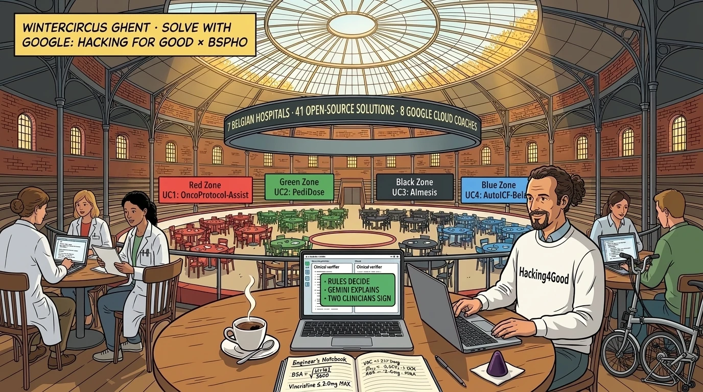
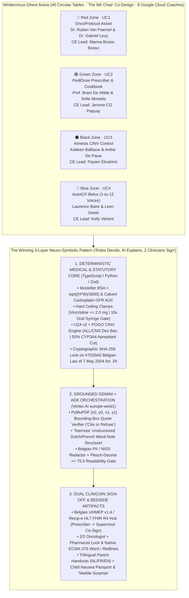
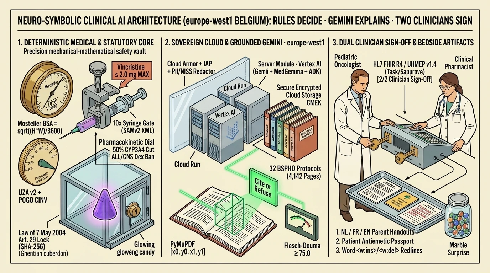
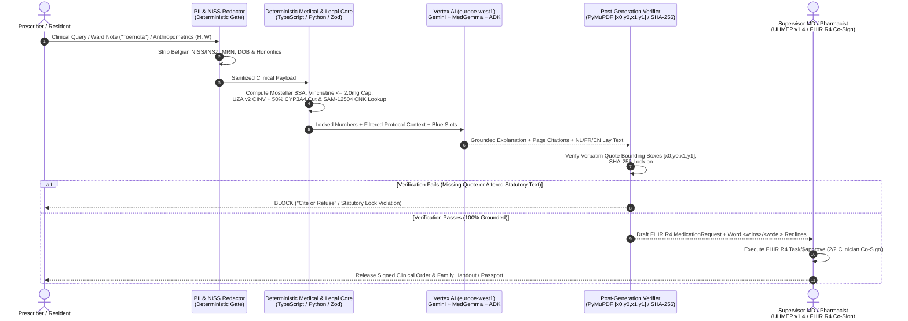
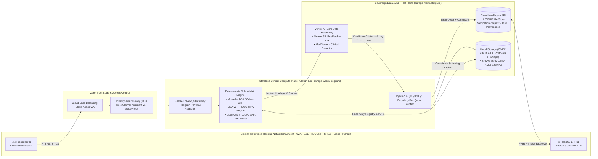

**Quick Answer:** When building clinical AI for high-stakes domains like **pediatric hemato-oncology**, pure end-to-end generative prompting is a patient-safety anti-pattern. Across **41 open-source solutions**, **2,100+ Git commits**, and **2,200+ automated tests** built in a single 6-hour arena sprint during **Solve with Google: Hacking for Good × BSPHO 2026** at **Wintercircus Ghent** ([`github.com/BelgianSPHO`](https://github.com/BelgianSPHO)), every winning team independently converged on the same three-layer neuro-symbolic architecture: **"Rules Decide, Gemini Explains, Two Clinicians Sign."** First, a **100% deterministic TypeScript/Python medical & statutory core** computes **[Mosteller Body Surface Area](https://pubmed.ncbi.nlm.nih.gov/3657876/)** ($\text{BSA} = \sqrt{(H \times W)/3600}$), enforces hard ceiling clamps (such as the **[`2.0 mg` absolute Vincristine neurotoxicity cap](https://www.ncbi.nlm.nih.gov/books/NBK537122/)** and the **[50% `CYP3A4` aprepitant/dexamethasone dose reduction](https://pubmed.ncbi.nlm.nih.gov/12816748/)**), and verifies **SHA-256 cryptographic locks** on mandatory **[Belgian Law of 7 May 2004 (Art. 29)](https://www.ejustice.just.fgov.be/cgi_loi/change_lg.pl?language=nl&la=N&cn=2004050732&table_name=wet)** paragraphs. Second, **[Vertex AI](https://cloud.google.com/vertex-ai/docs) (`Gemini` + [Google ADK](https://google.github.io/adk-docs/))** in `europe-west1` (Belgium) parses unstructured Dutch/French ward notes (*"Toernota"*), grounds every citation to exact **[PyMuPDF](https://pymupdf.readthedocs.io/) `[x0, y0, x1, y1]` page coordinates** (*"Cite or Refuse"*), and translates care plans into **NL/FR/EN parent handouts** and **8-year-old visual storyboards**. Third, **[Belgian UHMEP v1.4 / Recip-e](https://recip-e.be/) over [HL7 FHIR R4](https://hl7.org/fhir/R4/)** enforces dual-clinician co-signing (`Prescriber` $\rightarrow$ `Supervisor` / `Pharmacist`) before a single milligram reaches the ward.



---

## 1. From Rond-Point Schuman to the Elephant Dome: A Folding Bike, *Gentse Pleui*, and Zero Theatre

It is Sunday morning in Belgium, the first of November, and my second *espresso doppio* is finally catching up with a week of clinical plumbing.

If you spend your working weeks commuting between the **Brussels EU Quarter** and **Ghent**, you learn that the fifty-five kilometers of railway between *Brussel-Schuman* and *Gent-Sint-Pieters* actually separate two distinct laws of thermodynamics. In the Schuman bubble, an Interinstitutional Working Group can spend fourteen months, three Comitology annexes, and forty-two *cappuccinos* at *Place Jourdan* debating whether a semicolon in Recital 47 constitutes a "proportionate risk-based governance framework."

Then you step off the IC train at *Gent-Sint-Pieters*, snap open the hinge latches of your **folding bike** on the station forecourt, rattle across the tram tracks and damp cobblestones along the *Leie* and the *Korenlei*, coast past the weathered brick-and-steel decks of *De Krook*, and roll straight up to the old elephant ramp of **Wintercircus Ghent**. By the time you fold the frame back up under your arm at the arena entrance, you have crossed into what locals call the ***Gentse pleui***: that unmistakable, slightly irreverent Ghentian fold of character born from five centuries of *Stroppendragers* (the noose-bearers who famously looked Emperor Charles V in the eye in 1540 and refused to bow). Ghent has a congenital allergy to *dikke nekken* (swollen heads), vapourware, and self-important keynote theatre. If your idea does not survive a spoonful of *Tierenteyn* mustard and a `pytest` suite before five o'clock, the *Drie Torens* do not care how many slides you brought from Brussels.

Wintercircus itself is the architectural embodiment of that *Gentse pleui*. Built in 1894 as a stone-and-cast-iron hippodrome complete with indoor stables and underground elephant ramps, it burned down in 1920, was rebuilt in 1923, spent forty years after World War II as Mahy's grease-stained vintage car garage, and now stands resurrected under a soaring glass-and-steel canopy.

Normally, when two hundred software engineers gather under a glass dome with laptops and free caffeine, someone at Table 4 will spend the morning pitching a decentralized blockchain for artisanal sourdough.

On **Thursday, 29 October 2026**, nobody pitched a wrapper. And there was no appetite for personal spotlight, stage-hogging, or tech-bro bravado. **No pride, no fame—just putting things in order, doing the work, and solving for good.**

```
+---------------------------------------------------------------------------------------------------+
|      SOLVE WITH GOOGLE: HACKING FOR GOOD x BSPHO 2026 — WINTERCIRCUS GHENT ARENA TELEMETRY        |
+------------------------------------+------------------------------------+-------------------------+
| Arena Scale & Clinical Presence    | Engineering Output (6-Hour Sprint) | Quality & Safety Gates  |
+------------------------------------+------------------------------------+-------------------------+
| • 200+ Builders & Clinicians       | • 77 GitHub Repos (41 Solutions)   | • 2,200+ Passing Tests  |
| • 40 Circular 6-Seat Arena Tables  | • 2,100+ Git Commits in 1 Day      | • Up to 698 Tests/Repo  |
| • "The 6th Chair": Bedside MDs     | • 410,000+ Lines of Open Code      | • 0/41 Judge Jailbreaks |
| • 7/7 Belgian Reference Hospitals  | • 100% Coverage Across 4 Zones     | • 100% Synthetic Data   |
| • 8 Google Cloud Floor Coaches     | • github.com/BelgianSPHO           | • 100% Advisory-Only    |
+------------------------------------+------------------------------------+-------------------------+
```

---

## 2. The Days Before the Doors Opened: Ironing Out Qwiklabs Sandboxes and User Guides at Midnight

Before a single clinician or builder ever sat down under the Wintercircus dome, the real work happened in the quiet, unglamorous trenches during the days leading up to 29 October.

If you want forty circular tables of engineers and pediatric oncologists to build working clinical software in **six hours flat**, you cannot hand them a blank cloud account at 09:00 AM and wish them luck with IAM permissions. For days before the event, our Google Cloud customer engineering and lab operations crew lived inside **ephemeral GCP Qwiklabs sandbox templates, Terraform seed scripts, GCS bucket ACLs, and four-page onboarding user guides**:
- **Ironing Out the Qwiklabs Plumbing:** Pre-warming 40+ isolated Google Cloud Qwiklabs sandbox environments across `europe-west1` (Belgium) and `europe-west4` (Netherlands), verifying service-account token bindings, testing [Cloud Run](https://cloud.google.com/run/docs) buildpacks, pre-staging the synthetic clinical data buckets (`gs://...`), and dry-running every CLI command line by line so builders wouldn't lose two hours fighting `PERMISSION_DENIED` or organization policy locks. *(As planned for security and cost governance, all ephemeral Qwiklabs sandbox projects were cleanly torn down after the event, while the full source code remains permanently archived in [`github.com/BelgianSPHO`](https://github.com/BelgianSPHO).)*
- **Scrubbing the 4-Page User Guides:** Iterating over the zone-by-zone onboarding manuals, clinical benchmark prompts, and synthetic patient cases with the doctors until every milligram, protocol page number, and XML schema reference was watertight. *(Even then, arena physics humbled us: we put the `gcloud storage cp` one-liner on Page 4 of the 4-page user guide, and engineers with Gentse pleui start coding on Page 1—a lesson we fixed on the floor alongside our **8 Google Cloud coaches**.)*
- **Zero Ego, Just Infrastructure:** Nobody gets a trophy for fixing a broken Qwiklabs startup script at 23:30 on a Tuesday night or re-formatting a 4-page user guide so Table 17 knows where the FHIR R4 bundle lives. You do it because every minute of friction you remove on Wednesday night is a minute a software engineer can spend listening to a pediatric oncologist on Thursday morning.

Because what happens on Thursday morning matters. Every year in Belgium, roughly **350 to 400 children** are diagnosed with cancer. Because a cohort of 350 patients split across dozens of rare molecular subtypes is far too small for any single hospital to run statistically powered trials alone, **all seven Belgian pediatric hemato-oncology reference centers** (**UZ Gent**, **UZA Antwerp**, **UZ Leuven**, **HUDERF Brussels**, **Cliniques universitaires Saint-Luc Brussels**, **CHR Citadelle Liège**, and **CHU UCL Namur**) collaborate under the **[Belgian Society of Paediatric Haematology and Oncology (BSPHO)](https://bspho.be/)**.

That means bedside clinicians in Belgium operate at the collision point between **international academic clinical trial protocols** (frequently 250 to 1,100 pages of dense English PDFs) and **hyper-local Belgian statutory reality**:
- **Three national languages** (Dutch, French, and German—plus English in the trial protocols),
- **Federal pharmaceutical registries:** Belgium's official **[SAMv2 (`Authentic Source of Medications`)](https://www.ehealth.fgov.be/ehealthplatform/nl/service-samv2-authentic-source-of-medications)** XML database (which maps Virtual Medicinal Products `VMP` to commercial Actual Medicinal Products `AMP` and national dispensing `CNK` codes), the **[BCFI / CBIP](https://www.bcfi.be/)** (*Belgisch Centrum voor Farmacotherapeutische Informatie*), **[FAGG / AFMPS](https://www.fagg.be/)** (*Federal Agency for Medicines and Health Products*), and the **[Kinderformularium](https://www.kinderformularium.nl/)** pediatric dosing formulary,
- **Reimbursement mazes:** **[RIZIV / INAMI Chapter IV](https://www.riziv.fgov.be/nl/thema-s/verzorging-kosten-en-terugbetaling/wat-het-ziekenfonds-terugbetaalt/geneesmiddelen/terugbetaling-van-een-geneesmiddel)** prior-authorization rules vs. the **Belgian Pediatric Oncology Convention**, and
- **Strict statutory protections:** The **[Belgian Law of 7 May 2004 on Experiments on the Human Person](https://www.ejustice.just.fgov.be/cgi_loi/change_lg.pl?language=nl&la=N&cn=2004050732&table_name=wet)**, **[UHMEP v1.4](https://www.ehealth.fgov.be/)** (*Uniforme Huisarts- en Medische Elektronische Prescriptie*), and **[Recip-e](https://recip-e.be/)** over **[HL7 FHIR R4](https://hl7.org/fhir/R4/)**.

---

## 3. "The 6th Chair" Arena Pattern: What Happens When a Pediatric Pharmacist Audits Your Prompt

When **Dr. Uri Ilan** (Pediatric Oncologist at the Princess Máxima Center and Clinical Scientist at Google Research) and the **BSPHO** clinical leads opened the arena floor on Thursday morning, we enforced a physical systems-engineering constraint across all 40 circular tables that we call **"The 6th Chair" Pattern**:

> [!IMPORTANT]
> **The 6th Chair Rule:** Every circular table in the Wintercircus arena had **six chairs**, but builder teams were strictly capped at **five software engineers**. The **sixth chair** at every single table was reserved for rotating **BSPHO Use Case Leaders** (pediatric oncologists, hospital pharmacists, and trial coordinators wearing crisp white *"Use Case Leader"* sweatshirts) supported across the arena floor by **8 Google Cloud coaches**.

If you have ever watched a developer proudly demonstrate a "94% accurate RAG chatbot" to a Ghent or Antwerp pediatric clinical pharmacist who has to co-sign intrathecal methotrexate for a four-year-old, you know that the **6th Chair** changes the physics of software architecture faster than any EU AI Act delegated regulation ever written at Schuman.



With a pediatric oncologist sitting in the 6th chair, teams stopped asking *"How do we make the LLM sound smarter?"* and started asking: **"How do we guarantee that an LLM never computes a floating-point drug dose, never hallucinates a sub-protocol eligibility table, and never alters a single syllable of Article 29 of the Belgian Law of 7 May 2004?"**

The arena was divided into **Four Color-Coded Bedside Zones (`UC1`–`UC4`)**, tracing **One Child's Week in Treatment**. Every repository is openly inspectable in **[`github.com/BelgianSPHO`](https://github.com/BelgianSPHO)** (with governance and CI security guardrails in **[`BelgianSPHO/.github`](https://github.com/BelgianSPHO/.github)**).

---

## 4. Red Zone · UC1 (`OncoProtocol-Assist`): Navigating 4,142 Pages Without Hallucinating a Footnote

- **Clinical Leads:** **Dr. Ruben Van Paemel** (UZ Gent) & **Dr. Gabriel Levy** (Cliniques universitaires Saint-Luc, Brussels) · **Google Cloud CE Lead:** **Marina Bosso Bosso** (with Coach **Roderick Schaefer**)
- **The Clinical Corpus:** **32 master and sub-protocol documents totaling 4,142 PDF pages**—anchored by **[ALLTogether1 (`NCT04307576`)](https://clinicaltrials.gov/study/NCT04307576)** (Master Protocol + 7 specialized sub-protocols including Down Syndrome, Infant ALL, and `Ruxo-ALL`), **[HR-NBL2 (`NCT04221035`)](https://clinicaltrials.gov/study/NCT04221035)** (SIOPEN High-Risk Neuroblastoma), **[CHIP-AML22 (`NCT05992675`)](https://clinicaltrials.gov/study/NCT05992675)**, and **[FaR-RMS (`NCT04625907`)](https://clinicaltrials.gov/study/NCT04625907)**—paired with a hospital-by-hospital participation matrix across `UZA`, `UZG`, `UZL`, `HUDERF`, `UCL`, and `CHU`.

### Why Naive Vector RAG Is Unsafe at the Bedside

If a resident asks a standard chunk-and-embed RAG system, *"What is the consolidation pegaspargase dose for an Intermediate-Risk High patient in ALLTogether1, and when do we hold it for pancreatitis?"*, a dense vector retriever will happily pull a chunk from the `Standard Risk` arm on page 142 and splice it with a toxicity table from the `Down Syndrome` sub-protocol on page 318—because both chunks share high cosine similarity on `pegaspargase`. In pediatric oncology, mixing risk strata or ignoring a hospital's ethics activation status is unacceptable.

### Architectural Highlights from the Red Zone

- **Two-Tier Hospital Matrix & Coordinate-Bound Proof ([`BelgianSPHO/team-1`](https://github.com/BelgianSPHO/team-1) & [`BelgianSPHO/team-02`](https://github.com/BelgianSPHO/team-02)):** Before a single token reaches Gemini, `team-1` filters the 32-PDF corpus through a deterministic **Tier-1 Hospital Participation Matrix** and fires a **Tier-2 Sub-Protocol Escalation Alert** whenever a query touches `ALLTogether1`. Every clinical claim in the left pane is bound to exact PDF page numbers and **[PyMuPDF (`fitz`)](https://pymupdf.readthedocs.io/) `[x0, y0, x1, y1]` bounding-box coordinates** on the right-hand canvas: clicking a claim scrolls the PDF viewer to the exact paragraph and highlights the verbatim source sentence. If the substring verifier cannot locate the verbatim quote on the cited page, the response is blocked (*"Cite or Refuse"*).
- **The Pure *Gentse Pleui* Pivot — Offline Protocol Compilation ([`BelgianSPHO/team-08`](https://github.com/BelgianSPHO/team-08)):** With classic Ghentian pragmatism, `team-08` asked: *Why run stochastic RAG at query time over PDFs that only change when a trial amendment is ratified?* Under the motto **"Not a Chatbot Over PDFs"**, they built an offline compiler (`scripts/compile-protocol.ts`) using **[MuPDF](https://mupdf.com/)**, Gemini 2.5 Pro, and a strict **[Zod](https://zod.dev/) schema (`src/types/spec.ts`)** that compiles all 32 protocols *once* into structured consult sheets (`roadmaps`, `dosing`, `modifications`, `toxicities`) and runs a deterministic substring & number verifier (`verified: true | false`) before publishing static JSON packs. Bedside query latency is **0 ms** and runtime hallucination risk is **zero**.

---

## 5. Green Zone · UC2 (`PediDose`): Why Numbers Must Never Come From a Language Model

- **Clinical Leads:** **Prof. Dr. Bram De Wilde** & **Sofie Moreels** (Pediatric Clinical Pharmacist, UZ Gent) · **Google Cloud CE Lead:** **Jerome CG Paquay (`@jpaquay`)** (with Coaches **Gauthier Feuillen** & **Roderick Schaefer**)
- **The Clinical Mission:** Safely prescribing, compounding, reimbursing, and administering adult-formulated commercial drugs to children ranging from a **4 kg neonate** to an **18-year-old adolescent**, grounded in Belgium's **[SAMv2 (`SAM-12504` XML)](https://www.ehealth.fgov.be/ehealthplatform/nl/service-samv2-authentic-source-of-medications)**, **[BCFI / CBIP](https://www.bcfi.be/)**, **[Kinderformularium.nl](https://www.kinderformularium.nl/)**, and **[UHMEP v1.4 / Recip-e](https://recip-e.be/) over [HL7 FHIR R4](https://hl7.org/fhir/R4/)**.

In the **Green Zone (`UC2`)**, our job was to turn the most dangerous arithmetic traps in pediatric hospital pharmacy into deterministic code gates:

1. **The [Vincristine `2.0 mg` Hard Neurotoxicity Ceiling](https://www.ncbi.nlm.nih.gov/books/NBK537122/):** Vincristine is dosed by **[Mosteller Body Surface Area](https://pubmed.ncbi.nlm.nih.gov/3657876/)** ($\text{BSA} = \sqrt{(H_{\text{cm}} \times W_{\text{kg}})/3600}$) at $1.5\text{ mg/m}^2$, but is **strictly capped at `2.0 mg` absolute maximum single dose** for any patient with $\text{BSA} > 1.33\text{ m}^2$. An un-clamped calculation for a teenager ($\text{BSA } 1.65\text{ m}^2 \times 1.5 = 2.48\text{ mg}$) causes severe peripheral and cranial neurotoxicity.
2. **The `10x` Oral Syringe Volume Trap:** When prescribing liquid oral corticosteroids (prednisolone `10 mg/mL` commercial concentrate vs. `1 mg/mL` compounded dilution), a unit mismatch causes a **10-fold volume overdose (`3.0 mL` instead of `0.3 mL`)** unless the engine cross-checks the **SAMv2 `CNK` concentration** against safe single-syringe volume thresholds.
3. **[Posaconazole (`Noxafil`) Bioavailability](https://www.ema.europa.eu/en/medicines/human/EPAR/noxafil) & [RIZIV Chapter IV](https://www.riziv.fgov.be/) vs. `[HEM-iSmart](https://clinicaltrials.gov/study/NCT05203523)` Trial Locks:** Posaconazole oral suspension (`40 mg/mL`) and delayed-release tablets (`100 mg`) are **not milligram-for-milligram bioequivalent** due to gastric pH and food dependencies, and their Belgian RIZIV Chapter IV reimbursement rules differ by age—while targeted agents (`ruxolitinib`, `venetoclax`) inside the **[HEM-iSmart (`NCT05203523`)](https://clinicaltrials.gov/study/NCT05203523)** trial must trigger a **`0.00 EUR` hospital pharmacy trial billing lock**.

### Architectural Highlights from the Green Zone

- **"Numbers Never Come From a Model" ([`BelgianSPHO/team-15`](https://github.com/BelgianSPHO/team-15)):** `team-15` codified the golden law of the Green Zone in [`src/lib/calculator.ts`](https://github.com/BelgianSPHO/team-15): **100% of dose arithmetic** (Mosteller BSA, **[Calvert GFR-based Carboplatin AUC](https://pubmed.ncbi.nlm.nih.gov/2679981/)**, the `2.0 mg` Vincristine clamp, `SAM-12504` `mL` conversions, and cumulative lifetime anthracycline cardiotoxicity tracking) executes in deterministic TypeScript. Gemini is restricted to explaining interactions, translating SmPC nursing instructions (tablet dispersion, nasogastric tube flushing, cytotoxic PPE), and generating trilingual parent sheets—plus **"Marble Surprise"**, a therapeutic digital bead-jar reward game for children inspired by the Belgian *Kanjerketting* / *Collier du Courage* tradition.
- **Dual-Microservice SmPC Leaflet Analyst & FHIR R4 `Task/$approve` Co-Sign ([`BelgianSPHO/team-11`](https://github.com/BelgianSPHO/team-11) & [`BelgianSPHO/team-112`](https://github.com/BelgianSPHO/team-112)):** `team-11` paired a deterministic FastAPI dosing/reimbursement engine with an asynchronous SmPC/BCFI leaflet analyst, while `team-112` implemented the full **Belgian UHMEP v1.4** role gate: an assistant physician (`X-Role: assistant`) drafts an **[HL7 FHIR R4 `MedicationRequest`](https://hl7.org/fhir/R4/medicationrequest.html)**, which stays locked in `draft` until a supervising oncologist (`X-Role: supervisor`) executes the **[FHIR R4 `Task`](https://hl7.org/fhir/R4/task.html)** co-signature.

```typescript
// Deterministic Pediatric Dosing & Ceiling Clamp Pattern (Green Zone · UC2)
// Ref: Mosteller RD (NEJM 1987;317:1098) & ISMP High-Alert Vincristine 2.0 mg Cap

export interface PediatricDoseResult {
  readonly bsaM2: number;
  readonly rawCalculatedDoseMg: number;
  readonly finalClampedDoseMg: number;
  readonly ceilingClamped: boolean;
  readonly volumeMl: number;
  readonly syringeSafetyAlert: string | null;
}

export function calculateSafePediatricDose(params: {
  heightCm: number;
  weightKg: number;
  protocolMgPerM2: number;
  hardCeilingMg: number | null; // e.g., 2.0 mg absolute cap for Vincristine
  concentrationMgPerMl: number; // from Belgian SAMv2 (SAM-12504 AMPP/CNK XML)
  maxSingleSyringeVolumeMl: number;
}): PediatricDoseResult {
  if (params.heightCm <= 0 || params.weightKg <= 0 || params.concentrationMgPerMl <= 0) {
    throw new RangeError("Invalid anthropometric or SAMv2 concentration parameters.");
  }

  // 1. Mosteller Body Surface Area: sqrt((H_cm * W_kg) / 3600)
  const bsaM2 = Number(Math.sqrt((params.heightCm * params.weightKg) / 3600).toFixed(4));
  const rawCalculatedDoseMg = Number((bsaM2 * params.protocolMgPerM2).toFixed(3));

  // 2. Deterministic Hard Ceiling Clamp (prevents adolescent Vincristine neurotoxicity)
  const ceilingClamped =
    params.hardCeilingMg !== null && rawCalculatedDoseMg > params.hardCeilingMg;
  const finalClampedDoseMg = ceilingClamped ? params.hardCeilingMg! : rawCalculatedDoseMg;

  // 3. Volume conversion & 10x Oral Syringe Concentration Guardrail
  const volumeMl = Number((finalClampedDoseMg / params.concentrationMgPerMl).toFixed(2));
  const syringeSafetyAlert =
    volumeMl > params.maxSingleSyringeVolumeMl
      ? `CRITICAL VOLUME GATE: ${volumeMl} mL exceeds safe single-syringe threshold (${params.maxSingleSyringeVolumeMl} mL). Verify SAMv2 CNK concentration (${params.concentrationMgPerMl} mg/mL) for 10x dilution mismatch.`
      : null;

  return { bsaM2, rawCalculatedDoseMg, finalClampedDoseMg, ceilingClamped, volumeMl, syringeSafetyAlert };
}
```

---

## 6. Black Zone · UC3 (`AImesis`): Pharmacokinetic CINV Control With Cell-Level Provenance

- **Clinical Leads:** **Katleen Balliauw** & **Anthe De Pauw** (Pediatric Oncology Clinical Pharmacists, UZA Antwerp) · **Google Cloud CE Lead:** **Payam Ebrahimi** (with Coach **Juan Xia**)
- **The Clinical Mission:** Automating multi-day **Chemotherapy-Induced Nausea and Vomiting (CINV)** prophylaxis and rescue therapy using the **UZA July 2026 v2 Pediatric Antiemetic Policy** cross-checked against international **[POGO (Pediatric Oncology Group of Ontario) CINV Guidelines](https://www.pogo.ca/healthcare/guidelines/cinv/)**, while generating a trilingual **Patient Antiemetic Passport**.

Uncontrolled CINV in children undergoing multi-day chemotherapy (such as **[Rapid COJEC](https://pubmed.ncbi.nlm.nih.gov/20159811/)** in neuroblastoma) triggers dehydration, electrolyte derangement, and treatment delays. Yet prescribing antiemetics across a 5-day cycle is a **pharmacokinetic minefield** governed by four strict clinical rules:

1. **Multi-Day Emetogenic Risk Scoring (`HEC` / `MEC` / `LEC` / `Minimal`):** Each treatment day must be classified by the highest-risk agent or synergistic combination under **[POGO guidelines](https://www.pogo.ca/healthcare/guidelines/cinv/)**.
2. **The Absolute `ALL` & `CNS` Tumor Dexamethasone Contraindication:** While dexamethasone is a potent antiemetic for solid tumors, it is **strictly banned as an antiemetic** in **Acute Lymphoblastic Leukemia (`ALL`)** (where corticosteroids are already part of the antileukemic backbone) and in **[Central Nervous System (`CNS`) tumors](https://pmc.ncbi.nlm.nih.gov/articles/PMC6123882/)** (where dexamethasone tightens the blood-brain barrier and reduces chemotherapy penetration into brain tumor tissue).
3. **The [`50%` `CYP3A4` Aprepitant $\leftrightarrow$ Dexamethasone Dose Reduction](https://pubmed.ncbi.nlm.nih.gov/12816748/):** Aprepitant (an $\text{NK}_1$ receptor antagonist used in `HEC`) is a moderate inhibitor of hepatic **cytochrome P450 3A4 (`CYP3A4`)**, the enzyme that clears dexamethasone. Co-administering aprepitant doubles systemic steroid exposure unless **the dexamethasone antiemetic dose is deterministically halved (`-50%`)**.
4. **[Vincristine + Azole Neurotoxicity](https://pubmed.ncbi.nlm.nih.gov/21226646/) & [CredibleMeds QTc Prolongation](https://crediblemeds.org/):** Azole antifungals inhibit `CYP3A4`/`P-gp` clearance of vincristine (causing paralytic ileus and severe neuropathy), while $5\text{-HT}_3$ antagonists (`ondansetron`, `granisetron`, `palonosetron`) combined with rescue antiemetics (`domperidone`, `olanzapine`) must be checked against **[CredibleMeds](https://crediblemeds.org/)** for cumulative $\text{QTc}$ prolongation.

### Architectural Highlights from the Black Zone

- **Deterministic UZA v2 Engine + *"Toernota"* Ward-Note AI ([`BelgianSPHO/team-29`](https://github.com/BelgianSPHO/team-29)):** Protected behind Google Cloud **[Identity-Aware Proxy (IAP)](https://cloud.google.com/iap/docs)**, `team-29` combined a 100% deterministic Python rule engine (`backend/app/engine/`) with **"Toernota" AI**—a Gemini structurer that extracts multi-day chemotherapy timelines from free-text Dutch ward round notes (*"Toernota: 14j jongen, HR-NBL2 Rapid COJEC kuur B4..."*), applies the UZA v2 + POGO rules, halves dexamethasone when aprepitant is present, and prints a trilingual **Patient Antiemetic Passport**.
- **Cell-Level PDF Provenance & Dual-Clinician Signature Lock ([`BelgianSPHO/team-27`](https://github.com/BelgianSPHO/team-27), [`BelgianSPHO/team-28`](https://github.com/BelgianSPHO/team-28) & [`BelgianSPHO/team-30`](https://github.com/BelgianSPHO/team-30)):** Backed by **698 passing automated tests**, `team-27` coined the arena's defining motto—**"Rules Decide, Gemini Explains, Two Clinicians Sign"**—binding every cell in the generated antiemetic schedule to its exact source table cell (`page`, `table_id`, `row`, `col`) in the UZA policy PDF and requiring a **2/2 cryptographic sign-off** (Pediatric Oncologist + Clinical Pharmacist) before unlocking the family's mobile passport. Meanwhile, `team-30` added **Multi-Cycle Breakthrough Emesis Memory** (escalating Cycle $N+1$ prophylaxis when nausea occurred in Cycle $N$) alongside a child-friendly Emoji Playbook.

---

## 7. Blue Zone · UC4 (`AutoICF-Belux`): 1 Protocol to 12 Voices and the `#7030A0` *Cuberdon*-Purple Statutory Lock

- **Clinical Leads:** **Laurence Baire** (BSPHO Clinical Trial Coordinator) & **Leen Geets** (UZ Gent / [HIRUZ Health Innovation and Research Institute](https://www.uzgent.be/wetenschap/hiruz)) · **Google Cloud CE Lead:** **Kelly Vehent** (with Coaches **Manasa Kandula** & **Thomas Scherer**)
- **The Clinical Mission:** Transforming a single international trial protocol (`HEM-iSmart`, `Biomede 2.0`, `FORUM`) and the official **Belgian Feb 2025 Harmonized ICF Master Template** into **12 synchronized Informed Consent & Assent documents** ($4\text{ cohorts: Adult 18+, Parent, Teen 12–17 HIRUZ, Child 8–11 Visual Storyboard} \times 3\text{ languages: NL, FR, EN}$).

### The `#7030A0` *Neuzeke*-Purple Statutory Constraint

Anyone from Ghent who opened the official Belgian Informed Consent Master Template in the Blue Zone immediately noticed a delightful local coincidence: mandatory statutory text inside the template is formatted in hex **`#7030A0`—the exact violet-purple of a Ghentian *neuzeke* (*cuberdon*) from the Groentenmarkt**. And just like a *cuberdon*—whose crystalline outer sugar crust must remain 100% intact while the center stays soft—Belgian clinical trial ICFs reviewed by Hospital Ethics Committees (*Ethisch Comité / Comité d'Éthique*) enforce a strict **4-color typographic law**:

- **`#7030A0` (*Neuzeke*-Purple Text):** **100% Immutable Statutory Boilerplate**—specifically **[Article 29 of the Belgian Law of 7 May 2004](https://www.ejustice.just.fgov.be/cgi_loi/change_lg.pl?language=nl&la=N&cn=2004050732&table_name=wet)** (*no-fault sponsor liability insurance*, *"zelfs indien er geen sprake is van fout"* / *"même sans faute"*), **[GDPR Article 9](https://gdpr-info.eu/art-9-gdpr/)**, and **[EU Clinical Trials Regulation 536/2014 Art. 58](https://eur-lex.europa.eu/legal-content/EN/TXT/?uri=celex%3A32014R0536)** (25-year clinical trial archiving mandate). **Zero characters of `#7030A0` purple text may be altered or paraphrased by an AI model.**
- **`#0000FF` (Blue Text):** Protocol-specific variable slots (`[Study Name]`, `[Number of Visits]`, `[Blood Volume in mL and Teaspoons]`).
- **`#000000` (Black Text):** Clinical narrative that must be simplified to a **[Flesch-Douma Readability Score](https://nl.wikipedia.org/wiki/Flesch-Doumaformule) $\ge 75.0$** ($206.84 - 0.93 \times \text{ASL} - 77 \times \text{ASW}$, equivalent to **CEFR B1**) and shifted grammatically from **2nd person (`"uw bloed / votre sang"`)** to **3rd person (`"het bloed van uw kind / le sang de votre enfant"`)** for the Parent ICF.

### Architectural Highlights from the Blue Zone

- **Surgical ECMA-376 OpenXML Healer, SHA-256 Statutory Lock & Word Tracked Changes ([`BelgianSPHO/team-32-fr`](https://github.com/BelgianSPHO/team-32-fr) & [`BelgianSPHO/team-40`](https://github.com/BelgianSPHO/team-40)):** Rather than letting an LLM regenerate a 14-megabyte Word file (which corrupts tables and legal clauses), `team-32-fr` built a **`<0.2s` streaming RTF parser** and a **zero-dependency [ECMA-376 OpenXML](https://ecma-international.org/publications-and-standards/standards/ecma-376/) surgical engine (`docx_healer.py`)** that operates directly on `word/document.xml` runs (`<w:rPr><w:color w:val="7030A0"/></w:rPr>`). It verifies **100% SHA-256 byte identity** over every `#7030A0` statutory paragraph before and after Gemini fills the `#0000FF` blue slots, and writes all edits as **native Microsoft Word Tracked Changes (`<w:ins>` / `<w:del>`)** for instant Ethics Committee review.
- **MedGemma + Visual Storyboards & The Synthetic Reader Council ([`BelgianSPHO/team-04`](https://github.com/BelgianSPHO/team-04) & [`BelgianSPHO/team-36`](https://github.com/BelgianSPHO/team-36)):** `team-04` paired **[MedGemma](https://developers.google.com/health-ai-developer-foundations/medgemma)** protocol extraction with **Nano Banana** to illustrate reassuring comic-book storyboards for 8-to-11-year-olds, while `team-36` built an **"AI Council of Synthetic Readers"**—forcing every draft through an adversarial review by three simulated personas (**an exhausted parent at 23:00 on Day 1 of diagnosis**, **an 11-year-old child**, and **a Belgian Ethics Committee legal auditor**) before a coordinator ever exports the file.

---

## 8. The Master Blueprint & Sovereign Google Cloud Architecture

When we stepped back after the 16:00 code freeze and looked across all 41 open-source repositories in [`github.com/BelgianSPHO`](https://github.com/BelgianSPHO), the most important takeaway was **architectural convergence**. Across every bedside mission, the winning teams separated **deterministic clinical/statutory rules** from **grounded generative explanation** and **dual-clinician sign-off**:



### Solutions Dataflow: How Clinical Inputs Traverse the 3-Layer Safety Gate



### Sovereign Google Cloud Reference Architecture (`europe-west1` Belgium)

To run these workloads safely inside Belgian university hospitals, the winning patterns deploy onto a **zero-trust, EU-resident Google Cloud topology** centered in **`europe-west1` (St. Ghislain, Belgium)**:



| Clinical Zone | Deterministic Core (`100% Recall / 0% Drift`) | Grounded AI Layer (`Vertex AI europe-west1`) | Human Sign-Off (`Accountability`) | Open-Source Repositories ([`BelgianSPHO`](https://github.com/BelgianSPHO)) |
| :--- | :--- | :--- | :--- | :--- |
| **🔴 UC1 · `OncoProtocol`** | Hospital matrix, Tier-2 [`ALLTogether1`](https://clinicaltrials.gov/study/NCT04307576) escalation, **[PyMuPDF](https://pymupdf.readthedocs.io/)** `[x0,y0,x1,y1]` quote verifier | Cross-page protocol synthesis & trilingual (`NL`/`FR`/`EN`) parent handouts | Treating Pediatric Oncologist | [`team-1`](https://github.com/BelgianSPHO/team-1) · [`team-02`](https://github.com/BelgianSPHO/team-02) · [`team-08`](https://github.com/BelgianSPHO/team-08) |
| **🟢 UC2 · `PediDose`** | **[Mosteller BSA](https://pubmed.ncbi.nlm.nih.gov/3657876/)**, **[Calvert AUC](https://pubmed.ncbi.nlm.nih.gov/2679981/)**, **[`2.0 mg` Vincristine cap](https://www.ncbi.nlm.nih.gov/books/NBK537122/)**, `10x` syringe gate, **[SAMv2](https://www.ehealth.fgov.be/ehealthplatform/nl/service-samv2-authentic-source-of-medications)** XML | **[BCFI](https://www.bcfi.be/)** SmPC leaflet extraction (crushing/feeding-tube guide) & child medication sheets | **[UHMEP v1.4](https://recip-e.be/)** Prescriber $\rightarrow$ Supervisor **[FHIR `Task`](https://hl7.org/fhir/R4/task.html)** | [`team-15`](https://github.com/BelgianSPHO/team-15) · [`team-11`](https://github.com/BelgianSPHO/team-11) · [`team-112`](https://github.com/BelgianSPHO/team-112) |
| **⚫ UC3 · `AImesis`** | UZA v2 + **[POGO](https://www.pogo.ca/healthcare/guidelines/cinv/)** engine, ALL/CNS Dex ban, **[50% `CYP3A4` aprepitant cut](https://pubmed.ncbi.nlm.nih.gov/12816748/)**, **[CredibleMeds QTc](https://crediblemeds.org/)** | *"Toernota"* free-text Dutch/French ward-note parser & Patient Antiemetic Passport | `2/2` Oncologist + Clinical Pharmacist signature lock | [`team-29`](https://github.com/BelgianSPHO/team-29) · [`team-27`](https://github.com/BelgianSPHO/team-27) · [`team-28`](https://github.com/BelgianSPHO/team-28) · [`team-30`](https://github.com/BelgianSPHO/team-30) |
| **🔵 UC4 · `AutoICF-Belux`** | **[ECMA-376 OpenXML](https://ecma-international.org/publications-and-standards/standards/ecma-376/)** healer, SHA-256 lock on `#7030A0` **[Law of 7 May 2004 Art. 29](https://www.ejustice.just.fgov.be/cgi_loi/change_lg.pl?language=nl&la=N&cn=2004050732&table_name=wet)**, **[Flesch-Douma](https://nl.wikipedia.org/wiki/Flesch-Doumaformule)** $\ge 75$ | **[MedGemma](https://developers.google.com/health-ai-developer-foundations/medgemma)** slot extraction, 8–11yo visual storyboards & Synthetic Reader Council | Principal Investigator & Hospital Ethics Committee | [`team-32-fr`](https://github.com/BelgianSPHO/team-32-fr) · [`team-40`](https://github.com/BelgianSPHO/team-40) · [`team-04`](https://github.com/BelgianSPHO/team-04) · [`team-36`](https://github.com/BelgianSPHO/team-36) |

---

## 9. 19:00 Upstairs at Club Wintercircus: When the Arena Dust Settled Into the AI Circle Dinner

At **17:30**, after the jury finished deliberating and the top teams were recognized in the center ring, we didn't unfold our bikes to ride back to *Gent-Sint-Pieters* just yet. We walked straight upstairs to **Club Wintercircus** for the **19:00 AI Circle Executive Dinner**, where **135 HCLS executives, hospital CEOs, medical directors, and clinical leads** gathered to see what had just happened on the arena floor below them.

That sequence—**hackathon first, executive dinner immediately after**—changed the entire temperature of the evening. In Brussels, executive roundtables usually debate healthcare AI in the future subjunctive tense (*"What might clinical decision support look like in 2030 if we form a steering committee?"*). Upstairs at Club Wintercircus at 19:30, with our shoes still dusty from the arena floor and a live **Gemini 3.8 + Veo 3.1 Multi-Avatar Stage** welcoming the room, nobody spoke in the subjunctive tense. Hospital directors sat across twelve round tables discussing **working, open-source software that their own pediatric oncologists and clinical pharmacists had co-designed two hours earlier downstairs**.

Technology alone does not align seven university hospitals, forty circular tables, eight Google Cloud coaches, and 135 healthcare executives. A special standing ovation belongs to **Daphne van Beek**, the heart and operational engine behind *Solve with Google Belgium*, alongside **Dr. Uri Ilan**, the **BSPHO** clinical leads (**Dr. Ruben Van Paemel**, **Dr. Gabriel Levy**, **Prof. Dr. Bram De Wilde**, **Sofie Moreels**, **Katleen Balliauw**, **Anthe De Pauw**, **Laurence Baire**, and **Leen Geets**), and my fellow Google Cloud Zone & Sandbox Leads (**Marina Bosso Bosso**, **Payam Ebrahimi**, **Kelly Vehent**, **Murat Eken**, and **Lorenz Van den Brande**).

While the temporary Qwiklabs sandbox projects were cleanly decommissioned after the closing bell, every single repository in **[`github.com/BelgianSPHO`](https://github.com/BelgianSPHO)** remains permanently open-source (`Apache-2.0` / `MIT`), built on 100% synthetic data, and explicitly scoped as **advisory clinical decision support** (`Not a Certified CE/MDR Medical Device`). Now the quiet work continues: supporting **BSPHO** and Belgium's seven pediatric reference centers as they take these architectures into structured hospital validation.

No pride. No fame. Just putting the Qwiklabs sandboxes, the deterministic math, and the statutory locks in order—so doctors can get back to their patients, and children can get back to being kids. *Merci. Dank u wel.*
